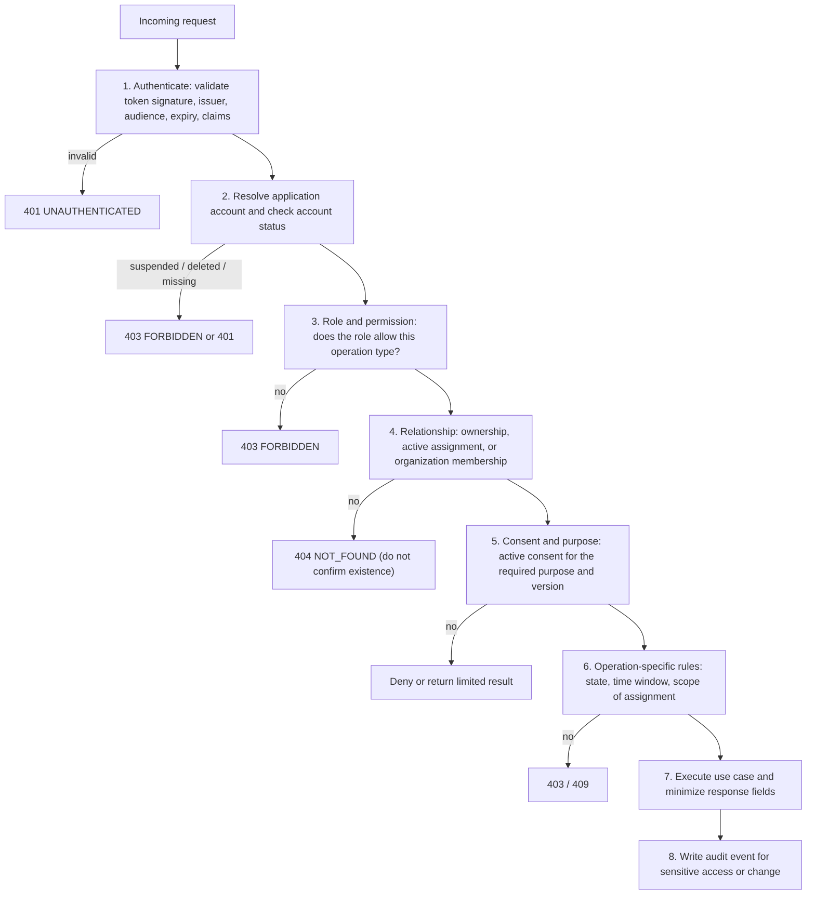

# Albo access control

**Status:** Proposed — requires security, privacy, and product-owner approval  
**Owner:** Security and privacy (shared / collaborator-led)  
**Related:** [Requirements](../01-project-foundation/REQUIREMENTS.md), [Architecture](../02-architecture-and-engineering/ARCHITECTURE.md), [System design](../02-architecture-and-engineering/SYSTEM_DESIGN.md), [API documentation](../02-architecture-and-engineering/API_DOCUMENTATION.md), [Database schema](../02-architecture-and-engineering/DATABASE_SCHEMA.md), [Integrations](../02-architecture-and-engineering/INTEGRATIONS.md), [UI/UX](../02-architecture-and-engineering/UI_UX.md)

## 1. Purpose and scope

This document defines how Albo decides **who may do what to which data, for what purpose**. It translates the access rules already stated in the requirements, architecture, API, and schema documents into one reviewable access-control contract.

It covers:

- Human actors and candidate roles
- Service identities (AI service, background jobs, external adapters)
- The authorization decision model and its enforcement points
- Consent- and purpose-aware access
- Provider, organization, and assignment scoping
- Administrative and operational access
- Access auditing, lifecycle, and testing

It does not select the identity provider, define final role permissions, or approve provider access for the first release. Those remain open decisions (see section 19). Anything marked `Proposed` or `To validate` must not be implemented as an approved rule until it is accepted and recorded in [DECISIONS.md](../06-technical-decisions/DECISIONS.md).

## 2. Access-control principles

1. **Deny by default.** A request is refused unless an explicit rule allows it.
2. **Server-side enforcement only.** The core API is the authorization boundary. The web client and the AI service never make trusted authorization decisions.
3. **Authentication is not authorization.** A valid token identifies the caller; it does not grant access to health information (API §4.1).
4. **A role alone never grants health-data access.** Access to another person's sensitive data requires role **and** relationship (assignment or explicit authorization) **and** applicable consent (DATABASE_SCHEMA §4.3, §13).
5. **Least privilege and minimum necessary.** Callers receive only the records, fields, and actions required for the operation.
6. **Purpose limitation.** Sensitive data is accessed only for a documented consent purpose (DP-001, DP-002).
7. **Caller identity comes from the token.** Client-supplied user identifiers never select whose data is returned (API §4.3).
8. **Privileged does not mean unrestricted.** Platform administrators and operators do not automatically see health records (FR-035).
9. **Every sensitive decision is auditable** without copying sensitive payloads into audit records (FR-038, FR-039).
10. **Safe denial.** Denials do not reveal whether another person, account, or record exists.

## 3. Authorization decision model

Every protected request passes the following checks in order. Failure at any step stops processing.

### 3.1 Decision inputs

| Input | Source | Trusted? |
|---|---|---|
| Caller subject ID | Validated access token | Yes, after validation |
| Account status | Albo `user_account` | Yes |
| Roles and organization memberships | Albo `role`, `organization_membership` | Yes |
| Assignments | Albo `provider_assignment` | Yes |
| Consent status | Albo `consent_record` and `consent_purpose` | Yes |
| Target resource and owner | Albo database lookup | Yes |
| Request body or query user IDs | Client | **No** — ignored or rejected on conflict |
| Client-side role or feature flags | Client | **No** |

### 3.2 Denial semantics

Follows the API error contract (API §6):

- `401 UNAUTHENTICATED` — missing or invalid token.
- `403 FORBIDDEN` — the caller is authenticated but the role or operation is not permitted, and revealing the resource does not leak information (for example, a citizen calling an admin route).
- `404 NOT_FOUND` — the target record is outside the caller's ownership or assignment. Use this instead of `403` so the response does not confirm another person's record exists.
- Consent failures on the caller's own data return a clear, user-facing limitation (FR-018); consent failures on another person's data are treated as a relationship failure (`404`).

## 4. Actors and candidate roles

Roles come from the API candidate list (API §4.2) and the requirement actors (REQUIREMENTS §2). Exact permissions require approval.

| Role | Actor | Default data reach | Status |
|---|---|---|---|
| `citizen` | Citizen | Own account and own records only | Proposed — first release |
| `provider` | Healthcare provider | Assigned citizens, within assignment scope and consent | Proposed — first-release inclusion is open |
| `facility_user` | Facility or pharmacy user | Own organization's facility data; citizen data only via assignment and consent | To validate |
| `community_health_worker` | Community health worker | Assigned people or approved group, within scope and consent | To validate |
| `platform_admin` | Platform administrator | Configuration and account administration; no automatic health-record access | Proposed |
| — | Family member | Only explicitly authorized information (REQUIREMENTS §2, UI/UX) | Later / to validate — no delegation model approved |

> Note: `support_operator` was previously listed as a candidate in `API_DOCUMENTATION.md` §4.2 without an actor in `REQUIREMENTS.md`; per [ADR-011](../06-technical-decisions/DECISIONS.md), it has been removed from the active role enum.

> A user may hold more than one role (for example, a provider who is also a citizen). Each request is evaluated against the context of the route being called: `/me/*` routes act on the caller's own records as a citizen; provider routes require the provider role and an assignment. Role contexts must not be merged to widen access.

### 4.1 Service identities

| Identity | Purpose | Access boundary |
|---|---|---|
| Core API | Trusted application boundary | Accesses database per module ownership |
| AI service | Rule/model computation | Receives only the minimum authorized input snapshot from the core API. Must not authorize users, fetch arbitrary records, or write to client-facing tables (API §9) |
| Background jobs | Reports, ingestion, notifications | Run under a dedicated service identity scoped to the job type; must re-check consent before processing personal data |
| External adapters | Weather, maps, facilities, identity, notifications | Hold only their own provider credentials; never make authorization decisions (ARCHITECTURE §4) |

## 5. Resources and data classification

Access rules follow the data classification in DATABASE_SCHEMA §12.

| Classification | Example resources | Minimum access condition |
|---|---|---|
| Public | Approved facility names, public facility services | Any user (authentication requirement for facility search to be decided) |
| Account | Profile, preferences, notification settings | Owner, or administrator for account-status operations only |
| Sensitive | Health inputs, check-ins, risk assessments, precise location | Owner; or provider/CHW with active assignment **and** consent; audited |
| Derived | Risk levels, recommendations, reports | Same as the sensitive source it derives from; provenance preserved |
| Highly restricted | Identity-provider data, credentials, private prompts, raw clinical records | Restricted service access only; never exposed to clients |
| Audit | Audit events | Approved operators through a restricted route; never editable |

## 6. Proposed permission matrix

`Own` = caller's own records. `Assigned` = records of a citizen with an active assignment to the caller **and** active consent for the relevant sharing purpose. `—` = no access.

| Resource / operation | citizen | provider | facility_user | community_health_worker | platform_admin |
|---|---|---|---|---|---|
| View own account and profile (`/me`, `/me/profile`) | Own | Own | Own | Own | Own |
| Update permitted profile fields | Own | Own | Own | Own | Own |
| Grant / withdraw consent | Own | — on behalf of others | — | — | — |
| Submit / correct health inputs and check-ins | Own | — (provider-recorded inputs require approval) | — | — | — |
| View health inputs and check-ins | Own | Assigned, read-only, scoped | To validate | Assigned, to validate | — |
| Request risk calculation | Own | — | — | — | — |
| View risk assessments | Own | Assigned (FR-031, FR-032) | To validate | Assigned, to validate | — |
| Record follow-up action | — | Assigned, without changing source data or AI output (FR-033) | To validate | To validate | — |
| Search facilities and providers | Yes | Yes | Yes | Yes | Yes |
| Create referral / consultation request | Own | Assigned, if workflow approved (FR-034) | To validate | To validate | — |
| Generate / view own reports | Own | Only via explicit `report_access` grant | — | — | — |
| Manage facility records | — | — | Own organization, to validate | — | Approved configuration |
| Manage accounts and roles | — | — | — | — | Account status and role administration only |
| Create / end provider assignments | — | — | To validate | — | To validate (see §9) |
| Manage consent purposes, rule versions, data sources | — | — | — | — | Approved configuration, change-audited |
| View audit events | — | — | — | — | Approved operators only, restricted route |

This matrix is a starting proposal derived from FR-031 to FR-035. Cells marked `To validate` require a product and security decision before implementation.

## 7. Relationship-based access: organizations and assignments

### 7.1 Assignment conditions

Access to a citizen's data by a provider or community health worker requires **all** of the following at request time (DATABASE_SCHEMA §4.3, §13):

- The caller holds the required role.
- The caller has an active membership in the organization named on the assignment.
- An assignment exists linking the caller (or approved group) to the citizen.
- The assignment status is active and the current time is within its start and end dates.
- The assignment scope covers the requested resource type and operation.
- The citizen has active consent for the relevant sharing purpose and version.

Removing any one condition (membership ended, assignment expired, consent withdrawn) must remove access on the next request. Cached authorization decisions, if used, must be short-lived and invalidated on these changes.

### 7.2 Assignment scope

Assignment scope should be an allowlist of resource types and operations (for example, view risk assessments, record follow-up), not a single "full access" flag. Group assignments for community health workers require a separate approved definition of "approved group" before implementation.

### 7.3 Organization isolation

Users in one organization must not see another organization's members, assignments, or citizen relationships unless an approved cross-organization workflow exists.

## 8. Consent- and purpose-aware access

- Every access to sensitive data is tied to a consent purpose code and version (DATABASE_SCHEMA §5).
- Consent is checked at the time of processing, not only at collection.
- Consent checks are performed by the core API before data is sent to the AI service, an external integration, or another person (INTEGRATIONS §16).
- The AI service receives the consent and authorization context as already-decided metadata; it does not re-decide it.

### 8.1 Consent withdrawal and access

API §8.2 requires withdrawal to define its effect on future collection, processing, stored derived outputs, and existing provider access. Proposed conservative default, pending approval:

| Effect | Proposed behavior |
|---|---|
| Future provider access under the withdrawn purpose | Denied from the next request |
| Future processing under the withdrawn purpose | Stopped; affected outputs shown as limited |
| Already-stored data and derived outputs | Governed by the retention and deletion policy (not yet approved) |
| Queued jobs relying on the withdrawn consent | Re-check consent before running; skip if withdrawn |

## 9. Administrative and operational access

- Administrators manage approved configuration and account status without automatic health-record access (FR-035).
- Administrative actions are audited, including role grants, account suspension, configuration changes, and audit-log access (API §11).
- Proposed separation of duties, to validate:
  - An administrator cannot grant themselves a provider role or assignment.
  - Role and assignment changes that widen access to health data require a second approver or an organization-level authority.
- Privileged accounts should use stronger authentication (for example, multi-factor authentication) once the identity provider is selected.
- Direct production database access is restricted to approved operators, time-bound, and recorded.

### 9.1 Emergency or break-glass access

No emergency or break-glass access to another person's health data is approved. It must not be implemented unless a reviewed procedure defines who may use it, under what conditions, how it is time-limited, how the citizen is informed, and how every use is reviewed. This relates to the open emergency and self-harm escalation decision (FR-024).

## 10. Authentication and session requirements

The identity provider remains open (managed OIDC, Keycloak, or a confirmed Supabase Auth boundary — TECH_STACK §7). Whatever is selected must support:

- Signed access tokens validated for signature, issuer, audience, expiry, and required claims.
- Short-lived access tokens; refresh behavior defined by the provider.
- Logout, account suspension, deletion, and token revocation behavior documented (INTEGRATIONS §6).
- Account recovery that does not reveal whether an account exists (UI/UX).
- No exposure of identity-provider-managed tables or records to clients (DP-003).
- Roles, assignments, and consent stored and decided in Albo, not trusted from identity-provider claims unless an approved decision says otherwise.

## 11. Enforcement points

| Layer | Responsibility |
|---|---|
| Web client | Hides navigation the user cannot use; never trusted for authorization |
| API gateway / middleware | Token validation, request ID, rate limiting |
| Core API identity-and-access module | Resolves account, roles, memberships, assignments; exposes a single policy interface to other modules |
| Domain modules | Call the policy interface for every protected operation; scope every query by owner or assignment |
| Database | Foreign keys and constraints; row-level security only if approved (open decision) |
| AI service | Validates the service-to-service identity of the core API; accepts no end-user tokens |
| Object storage | Private buckets; short-lived, scoped download URLs issued only after authorization (INTEGRATIONS §14) |

### 11.1 Implementation rules

- Authorization logic lives in one policy module of the core API; it is not duplicated in controllers, the frontend, or the AI service.
- Queries for user-owned data filter by the authenticated owner or by an authorized assignment set at the query level, not by filtering results afterwards.
- Authorization is applied **before** pagination (API §5.4).
- Resource identifiers are opaque; access never relies on IDs being hard to guess.
- Responses use explicit field allowlists per role so that a broader database record does not leak extra fields.

## 12. Location access

- A citizen's precise location is not exposed to a facility, provider, or other party unless the citizen authorizes that use (FR-028, API §8.5).
- Facility search uses explicit, bounded location filters.
- Where precision is not needed, use area, grid, or reduced-precision references (DATABASE_SCHEMA §6.3).

## 13. Reports and shared outputs

- Reports are owned by the citizen who requested them.
- Any other party's access requires an explicit `report_access` record with an expiry (DATABASE_SCHEMA §10.3).
- Downloads use short-lived, authorized URLs; report links expire where appropriate (UI/UX).
- Report generation and sharing are audited.

## 14. Access auditing

Audit events are recorded for (API §11, FR-038):

- Access to another person's sensitive records (allowed and denied)
- Consent grants and withdrawals
- Role, membership, and assignment changes
- Account suspension, reactivation, and deletion
- Administrative configuration changes
- Audit-log access
- Report generation and sharing
- Repeated authorization failures (as a security signal)

Each event contains actor, actor type, action, resource type, resource ID, outcome, time, request ID, and where applicable organization and purpose code. Events must not contain tokens, passwords, raw prompts, or unnecessary health, identity, or precise-location data (FR-039, DATABASE_SCHEMA §11).

## 15. Access lifecycle

| Stage | Proposed rule |
|---|---|
| Provisioning | Citizens self-register. Staff roles are granted only through an approved organization onboarding process (to validate). |
| Assignment | Created with explicit scope, organization, start date, and end date; audited. |
| Review | Active staff roles and assignments are reviewed periodically; review frequency to be decided. |
| Change | Role or scope changes take effect on the next request and are audited. |
| Deprovisioning | Leaving an organization ends memberships and assignments; account suspension stops all access. |
| Deletion | Follows the retention and deletion policy once approved (DP-007). |

## 16. Testing requirements

Authorization tests are mandatory for every protected endpoint (NFR-002, API §12). Minimum cases:

- Unauthenticated request is rejected.
- Expired, wrongly signed, wrong-issuer, and wrong-audience tokens are rejected.
- A citizen cannot read or modify another citizen's records, including by changing IDs in the path or body.
- A provider without an assignment cannot access a citizen's data.
- A provider with an expired, ended, or out-of-scope assignment is denied.
- A provider with a valid assignment is denied after the citizen withdraws the sharing consent.
- A provider in one organization cannot access another organization's assignments.
- A platform administrator cannot read health inputs, check-ins, or risk assessments.
- A suspended account is denied.
- Denials of other people's records return a response that does not confirm their existence.
- Pagination and search do not reveal inaccessible records.
- The AI service rejects requests without a valid service identity.
- Sensitive access and denials create audit events without sensitive payloads.

Tests use synthetic users and data only.

## 17. First-release access-control scope

Aligned with the first vertical slice in [PROJECT_STATUS.md](../PROJECT_STATUS.md):

- Citizen authentication and application-account mapping
- Citizen-only access to own profile, consent, health input, and risk assessment
- Consent check before risk calculation
- Server-side policy module with deny-by-default behavior
- Audit events for consent changes, risk calculation, and denials
- Authorization tests proving one citizen cannot access another's data

Provider, facility, community-health-worker, family, and support-operator access are excluded from the first vertical slice until their roles, assignments, and consent purposes are approved.

## 18. Acceptance criteria

The access-control design is ready for implementation when:

- The identity provider and token claims are selected.
- First-release roles and their permissions are approved.
- Provider-access inclusion for the first release is decided.
- Consent purposes required for each access path are defined.
- Consent-withdrawal effects on access are approved.
- The policy-module design and denial semantics are agreed.
- The authorization test matrix is accepted.
- Decisions are recorded in [DECISIONS.md](../06-technical-decisions/DECISIONS.md).

## 19. Open access-control decisions

- Final identity provider and token claims
- Final role list and permissions; whether `support_operator` is needed and what it may do
- Whether provider access is in the first release
- `facility_user` and `community_health_worker` data reach and group-assignment model
- Family-member delegation model, if any
- Who may create and end provider assignments
- Separation-of-duties rules for administrators
- Consent-withdrawal effects on existing access and stored outputs
- Whether facility search requires authentication
- Multi-factor authentication requirements for privileged roles
- Row-level security and database-role strategy
- Emergency or break-glass procedure (currently not approved)
- Access-review frequency and audit-log access roles

## 20. Resolved documentation discrepancies

| Topic | Observation | Resolution (`2026-11-19`) |
|---|---|---|
| `support_operator` role | Listed in API §4.2 candidate roles but not defined as an actor in REQUIREMENTS §2 | **Resolved in [ADR-011](../06-technical-decisions/DECISIONS.md):** Removed `support_operator` from the role enum (`citizen`, `provider`, `facility_user`, `community_health_worker`, `platform_admin`) |
| Identity provider | DP-003 references Supabase/Auth-managed identity data while TECH_STACK leaves the provider open | **Resolved in [ADR-011](../06-technical-decisions/DECISIONS.md):** Standard OIDC/JWT validation boundary in NestJS with Supabase Auth as the default managed cloud provider and offline OIDC-compatible JWTs for local/CI testing |
