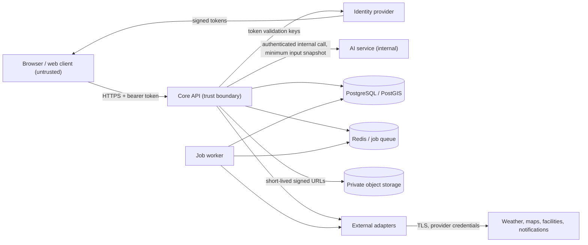

# Albo security

**Status:** Proposed — requires security, privacy, and architecture-owner approval  
**Owner:** Security and privacy (shared / collaborator-led)  
**Related:** [Access control](ACCESS_CONTROL.md), [Data privacy](DATA_PRIVACY.md), [Threat model](THREAT_MODEL.md), [Requirements](../01-project-foundation/REQUIREMENTS.md), [Architecture](../02-architecture-and-engineering/ARCHITECTURE.md), [System design](../02-architecture-and-engineering/SYSTEM_DESIGN.md), [API documentation](../02-architecture-and-engineering/API_DOCUMENTATION.md), [Database schema](../02-architecture-and-engineering/DATABASE_SCHEMA.md), [Integrations](../02-architecture-and-engineering/INTEGRATIONS.md), [Tech stack](../02-architecture-and-engineering/TECH_STACK.md)

## 1. Purpose and scope

This document defines the security controls Albo must apply to protect sensitive health, wellbeing, identity, location, and provider information across the web client, core API, AI service, data stores, background jobs, and external integrations.

It consolidates the security rules already stated in the requirements, architecture, API, schema, integration, and stack documents, and proposes the controls still needed before implementation and production use.

Related responsibilities are split as follows:

| Topic | Document |
|---|---|
| Who may access what, roles, assignments, consent-aware authorization | [ACCESS_CONTROL.md](ACCESS_CONTROL.md) |
| Lawful basis, consent, retention, deletion, data-subject rights | [DATA_PRIVACY.md](DATA_PRIVACY.md) |
| Assets, attackers, abuse cases, and risk ratings | [THREAT_MODEL.md](THREAT_MODEL.md) |
| AI-specific harms and safeguards | [AI_SAFETY.md](../04-artificial-intelligence/AI_SAFETY.md) |

Items marked `Proposed` or `To validate` are not approved implementation rules until accepted and recorded in [DECISIONS.md](../06-technical-decisions/DECISIONS.md).

## 2. Security objectives

| Objective | Meaning for Albo |
|---|---|
| Confidentiality | Sensitive data is visible only to authorized parties for an approved purpose |
| Integrity | Health inputs, consent records, risk outputs, and audit events cannot be altered silently or without authorization |
| Availability | Core journeys degrade safely when dependencies fail; data is recoverable from backups |
| Accountability | Sensitive access and changes are attributable through audit events |
| Safety | Security failures never produce fabricated or misleading health outputs (NFR-005) |

## 3. Security principles

1. **Defense in depth.** No single control (token, role, network, encryption) is relied upon alone.
2. **Secure by default.** New endpoints, buckets, jobs, and integrations start closed and private.
3. **Least privilege** for users, services, database roles, CI pipelines, and operators.
4. **Minimize data.** Collect, transmit, log, and retain only what an approved purpose requires (DP-001, AI-002).
5. **Zero trust in the client.** The browser is never an authorization, validation, or calculation boundary.
6. **No secrets in code** or documentation, logs, fixtures, or client bundles (DP-004).
7. **Synthetic data only** outside production (DP-005).
8. **Fail safely.** Errors return safe messages and never leak internals or invent results.
9. **Auditable change.** Configuration, schema, rule, and permission changes are versioned and reviewed.

## 4. Trust boundaries

| Boundary | Main controls |
|---|---|
| Browser → core API | TLS, token validation, input validation, rate limiting, CORS, safe errors |
| Identity provider → core API | Signature, issuer, audience, expiry, and claim validation |
| Core API → AI service | Service-to-service authentication, private network, minimum input, timeouts |
| Core API / worker → database | Least-privilege database roles, TLS where supported, parameterized queries |
| Core API → object storage | Private buckets, scoped short-lived URLs, no predictable paths |
| Adapters → external providers | Secret-managed credentials, TLS validation, timeouts, minimum payloads |
| Operators → production | Restricted, time-bound, audited access |

## 5. Identity and authentication

- Albo does not implement its own password storage or token issuance; it uses the selected standards-based identity provider (TECH_STACK §7).
- The core API validates every token's signature, issuer, audience, expiry, and required claims (API §4.1).
- Identity-provider-managed records are never exposed to clients (DP-003).
- Sign-in, recovery, and error messages do not reveal whether an account exists (UI/UX).
- Authentication endpoints are rate-limited (API §10).
- Proposed: multi-factor authentication for provider, facility, community-health-worker, and administrator accounts once the identity provider supports it.
- Logout, suspension, deletion, and token-revocation behavior must be documented for the chosen provider (INTEGRATIONS §6).

Authorization rules are defined in [ACCESS_CONTROL.md](ACCESS_CONTROL.md).

## 6. Data protection

### 6.1 Classification

Data handling follows the classification in DATABASE_SCHEMA §12: public, account, sensitive, highly restricted, and derived. The classification must be confirmed by the privacy and security owners before production use.

### 6.2 In transit

- All external traffic uses HTTPS/TLS with certificate validation; plaintext HTTP is redirected or refused.
- Internal service traffic (core API ↔ AI service, database, Redis, object storage) uses TLS or an approved private network, to be decided with hosting.
- Integrations must keep TLS and certificate validation enabled (INTEGRATIONS §16).

### 6.3 At rest

Data is protected at rest according to the approved security design (DP-006). Proposed baseline:

| Store | Proposed protection |
|---|---|
| PostgreSQL | Provider-managed storage encryption; encrypted backups |
| Object storage | Server-side encryption, private buckets |
| Redis | No durable health records; minimum payloads; authentication enabled |
| Backups | Encrypted, access-restricted, expiry defined |
| Highly restricted fields | Application-level or field-level encryption to be decided per field |

Key ownership, rotation, and storage (hosting key-management service or equivalent) remain open decisions.

### 6.4 Minimization in transit to other components

- The AI service receives only a minimum necessary authorized input snapshot (API §9).
- Job payloads contain references and minimum data, never credentials (TECH_STACK §6).
- Notification bodies avoid health details and prefer protected in-app references (DATABASE_SCHEMA §10.2).
- Health information is kept out of URLs, analytics events, and browser logs (TECH_STACK §3).

## 7. Secrets management

- Secrets (database credentials, provider API keys, signing keys, service-to-service credentials) are stored in an approved secret manager or the hosting platform's secret store—never in source code, documentation, fixtures, logs, or client bundles (DP-004).
- Each environment has separate secrets; production secrets are never used in development or tests.
- Client-exposed configuration (for example, public map keys) is restricted by domain or scope where the provider supports it and treated as public.
- Secrets are rotated on a defined schedule and immediately after suspected exposure (schedule to be decided).
- CI runs secret scanning on every change (TECH_STACK §11).
- `.env` files with real values are never committed; only example files with placeholders are allowed.

## 8. Application security

### 8.1 Input validation

- All input is validated server-side against explicit schemas.
- Health inputs use an allowlist of fields, types, units, and value ranges; unapproved clinical fields are rejected (API §8.3).
- Filtering, sorting, and pagination accept only documented parameters; no arbitrary query expressions (API §5.4).
- Database access uses the selected ORM or parameterized queries; string-built SQL is prohibited.

### 8.2 Output and error handling

- Responses use explicit field allowlists so internal fields never leak.
- Errors follow the API error contract and never return stack traces, SQL errors, tokens, credentials, raw prompts, or sensitive payloads (API §6).
- The web client relies on framework output encoding; raw HTML rendering of user or AI content is prohibited unless sanitized and approved.

### 8.3 Web client protections (Proposed)

- Strict Content Security Policy appropriate for Next.js
- `Strict-Transport-Security`, `X-Content-Type-Options`, `Referrer-Policy`, and frame-embedding protection
- CORS restricted to approved Albo origins
- CSRF protection if cookie-based sessions are used
- Tokens stored according to the identity provider's recommended secure pattern; no tokens in `localStorage` unless an approved decision accepts the risk
- No sensitive data in client-side analytics

### 8.4 Abuse protection

- Rate limits by route category and actor for authentication, assistant messages, risk calculations, reports, referrals, and ingestion (API §10).
- Idempotency keys for retryable mutations that could duplicate records, notifications, reports, or referrals (API §10).
- Bounded request sizes and timeouts on all endpoints.

### 8.5 Server-side request and file safety

- Adapters call only configured provider hosts; user input never selects an arbitrary outbound URL.
- File uploads are out of first-release scope; if introduced, files are type-checked, size-limited, scanned, and stored privately (INTEGRATIONS §14).
- Webhooks verify signatures and prevent replay (INTEGRATIONS §16).

## 9. AI-service security

- The AI service is not publicly reachable; it accepts only authenticated calls from the core API (API §9).
- It does not accept end-user tokens, authorize users, fetch arbitrary records, or write to client-facing tables (ARCHITECTURE §9).
- It holds no database credentials beyond what an approved design requires.
- Inputs and outputs are validated against versioned schemas.
- Raw prompts, model inputs, and unrestricted assistant responses are not logged (ARCHITECTURE §14).
- If an external model provider is introduced, its data retention, training use, residency, and terms must be reviewed before any personal data is sent (open decision in TECH_STACK §16).
- Assistant-specific threats such as prompt injection, data leakage, and unsafe advice are handled in [AI_SAFETY.md](../04-artificial-intelligence/AI_SAFETY.md) and [THREAT_MODEL.md](THREAT_MODEL.md).

## 10. Integration security

Every integration must pass the checklist in INTEGRATIONS §16 before it is enabled, including secret-managed credentials, TLS, least privilege, minimum payloads, consent checks before personal data leaves Albo, log redaction, webhook verification, rate limits, audit of sensitive transfers, and review of the provider's terms, residency, and breach process.

External data never becomes a clinical input automatically (DATABASE_SCHEMA §7.2).

## 11. Infrastructure and environment security

- Development, test, staging, and production are separated in configuration, credentials, data, and access (ARCHITECTURE §12).
- Production contains the only real user data; other environments use synthetic data.
- Database, Redis, AI service, and worker are not exposed to the public internet.
- Database roles follow module ownership and least privilege (DATABASE_SCHEMA §16); application roles cannot alter schema at runtime.
- Migrations run through a reviewed pipeline step, not from developer machines against production.
- Container images use minimal maintained base images, run as non-root, and are rebuilt for security patches.
- Production operator access is restricted to named people, time-bound, and audited.

## 12. Logging, monitoring, and auditing

### 12.1 Logging rules

Logs, traces, and metrics must not contain passwords, tokens, raw health records, precise locations without justification, raw prompts, or unrestricted assistant responses (DP-008, NFR-015, TECH_STACK §12).

Proposed controls:

- Structured logging with an allowlist of fields
- Automatic redaction of authorization headers and known sensitive keys
- Request IDs for correlation instead of user content
- Log retention and access restricted and defined per environment

### 12.2 Security monitoring

Monitor and alert on (ARCHITECTURE §14):

- Authentication and authorization failure spikes
- Rate-limit triggers and abuse patterns
- Unusual access volume by a provider or operator
- Integration credential failures
- Job dead letters involving sensitive workflows
- Audit-log access

### 12.3 Audit events

Audit events are defined in API §11 and [ACCESS_CONTROL.md](ACCESS_CONTROL.md) §14. Audit records are append-oriented, access-restricted, and protected from ordinary modification (DATABASE_SCHEMA §11).

## 13. Secure development lifecycle

| Stage | Control |
|---|---|
| Design | Security and privacy impact noted for new features; threat model updated for new data flows |
| Implementation | Follow [CODING_STANDARDS.md](../05-development-standards/CODING_STANDARDS.md); no secrets or real data |
| Review | Pull-request review required; security-sensitive changes (auth, consent, access, crypto, integrations) need a second reviewer — Proposed |
| CI | Lint, type check, tests, API contract checks, dependency scanning, secret scanning, migration checks (TECH_STACK §11) |
| Testing | Authorization, consent, sensitive-field exposure, and audit tests (API §12); see [TESTING_STRATEGY.md](../05-development-standards/TESTING_STRATEGY.md) |
| Release | Security checklist reviewed before staging and production promotion |
| Operation | Monitoring, patching, access reviews, incident response |

Proposed verification baseline: use the OWASP Application Security Verification Standard (ASVS) and the OWASP API Security Top 10 as review checklists. To validate with the team.

## 14. Vulnerability and dependency management

- Dependencies are pinned through lockfiles for the web client, core API, and AI service.
- Automated dependency vulnerability scanning runs in CI.
- Critical and high vulnerabilities in reachable code are fixed or formally risk-accepted before release; target fix times to be decided.
- New dependencies are reviewed for maintenance, license, and necessity (TECH_STACK §14).
- Proposed: a documented channel for responsibly reporting security issues once Albo is publicly accessible.

## 15. Incident response (Proposed)

No incident-response process is approved yet. Before production health data is used, define:

1. **Detection and reporting** — who can raise an incident and how.
2. **Triage** — severity levels and the incident owner.
3. **Containment** — revoking credentials, disabling integrations, suspending accounts.
4. **Investigation** — using audit events and logs without broadening data exposure.
5. **Notification** — obligations to affected users, partners, and authorities under applicable law (to validate).
6. **Recovery** — restoring service and data from verified backups.
7. **Review** — post-incident review and recorded follow-up actions.

## 16. Backup and recovery

- Backups are encrypted, access-restricted, and stored separately from the primary database.
- Restoration is tested before production health data is accepted (ARCHITECTURE §13).
- Backup retention respects the retention and deletion policy in [DATA_PRIVACY.md](DATA_PRIVACY.md).
- Recovery point and recovery time objectives remain open decisions (NFR-006).

## 17. Development and test data

- Fixtures, seeds, demos, screenshots, prompts, and AI evaluation sets use synthetic or properly de-identified data only (DP-005).
- Production data is never copied into development, test, or staging.
- Production credentials are never used in automated tests (INTEGRATIONS §17).

## 18. First-release security baseline

Aligned with the first vertical slice in [PROJECT_STATUS.md](../PROJECT_STATUS.md):

- Selected identity provider with server-side token validation
- Deny-by-default authorization and citizen-only data access ([ACCESS_CONTROL.md](ACCESS_CONTROL.md) §17)
- HTTPS everywhere; private database, Redis, and AI service
- Secret manager or platform secret store; no secrets in the repository
- Server-side schema validation and allowlisted health inputs
- Safe error contract and response field allowlists
- Redacted structured logging and audit events for sensitive actions
- Rate limits on authentication, risk calculation, and other abuse-prone routes
- CI with tests, dependency scanning, and secret scanning
- Synthetic data in all non-production environments

## 19. Acceptance criteria

The security design is ready for first-release implementation when:

- The identity provider and token handling pattern are selected.
- Hosting, network boundaries, and secret management are chosen.
- At-rest encryption and key-management responsibilities are agreed.
- Logging redaction rules and log retention are defined.
- CI security checks are specified.
- The threat model covers first-release data flows.
- Incident-response ownership is assigned before production data is used.
- Decisions are recorded in [DECISIONS.md](../06-technical-decisions/DECISIONS.md).

## 20. Open security decisions

- Identity provider, token storage pattern, and MFA policy
- Hosting provider, network topology, and data residency
- Secret manager and rotation schedule
- Field-level encryption scope and key management
- Internal service-to-service authentication method (for example, mutual TLS or signed service tokens)
- Log and audit retention periods and access roles
- Vulnerability fix-time targets
- Security verification baseline (proposed OWASP ASVS / API Top 10)
- Incident-response owner and notification obligations
- Recovery point and recovery time objectives
- Applicable legal and regulatory security obligations in Rwanda (to validate with [DATA_PRIVACY.md](DATA_PRIVACY.md))
