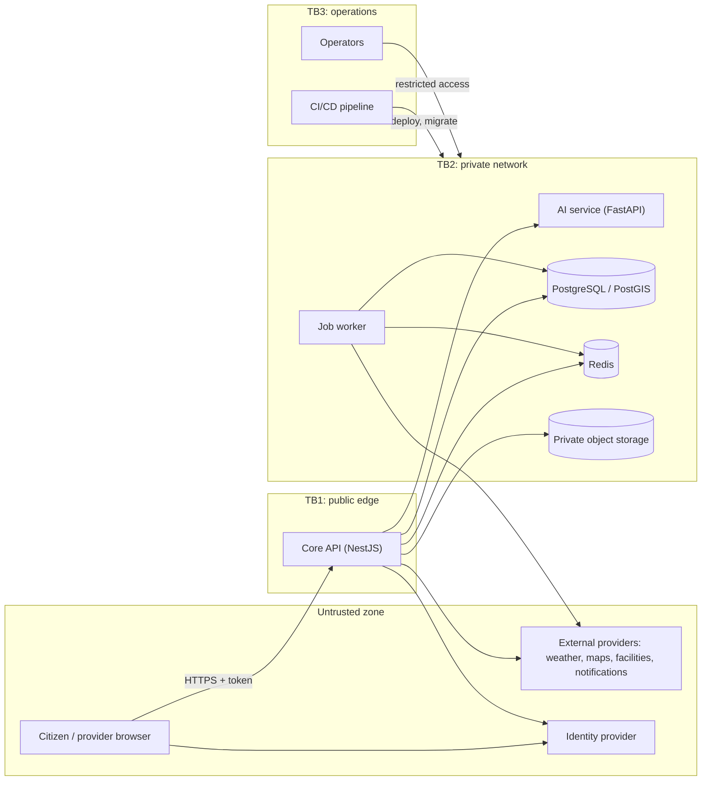

# Albo threat model

**Status:** Approved — design-time threat model  
**Owner:** Security and privacy (shared / collaborator-led)  
**Method:** STRIDE per trust boundary, plus health-, privacy-, and AI-specific abuse cases  
**Related:** [Security](SECURITY.md), [Access control](ACCESS_CONTROL.md), [Data privacy](DATA_PRIVACY.md), [Architecture](../02-architecture-and-engineering/ARCHITECTURE.md), [System design](../02-architecture-and-engineering/SYSTEM_DESIGN.md), [API documentation](../02-architecture-and-engineering/API_DOCUMENTATION.md), [Integrations](../02-architecture-and-engineering/INTEGRATIONS.md), [AI safety](../04-artificial-intelligence/AI_SAFETY.md)

## 1. Purpose and scope

This document identifies what an attacker or a failure could do to Albo, how likely and harmful that would be, and which controls reduce the risk. It is a design-time model: no code exists yet, so it is based on the proposed architecture and must be updated when the design or implementation changes.

In scope: web client, core API, AI service, PostgreSQL/PostGIS, Redis and job worker, object storage, identity provider integration, external adapters, CI/CD, and operator access.

Out of scope until approved: live video consultations, device integrations, EHR exchange, mental-wellness hub, and external AI model providers. Each requires a model update before it is enabled.

## 2. Assets

| ID | Asset | Why it matters |
|---|---|---|
| A1 | Health inputs and wellbeing check-ins | Sensitive health data; harm if disclosed |
| A2 | Assistant conversations | May reveal mental-health or self-harm information |
| A3 | Risk assessments, recommendations, reports | Derived sensitive data; integrity affects user safety |
| A4 | Consent records | Legal basis for processing; tampering enables unlawful access |
| A5 | Roles, memberships, and provider assignments | Control who can see other people's data |
| A6 | Precise location | Physical safety and privacy |
| A7 | Identity data and access tokens | Account takeover |
| A8 | Secrets and credentials | Full system or vendor compromise |
| A9 | Rule sets and rule/model versions | Tampering changes health outputs for everyone |
| A10 | Facility and environmental data | Wrong data misdirects people seeking care |
| A11 | Audit events | Accountability and incident investigation |
| A12 | Availability of core journeys | People rely on Albo for guidance and facility access |

## 3. Threat actors

| Actor | Motivation | Capability |
|---|---|---|
| External attacker | Data theft, extortion, disruption | Automated scanning, credential stuffing, exploitation of known flaws |
| Malicious or curious user | Access another person's data, abuse features | Valid account, crafted requests |
| Malicious or compromised provider account | Access people outside their assignment | Valid staff role |
| Insider / operator | Curiosity, coercion, error | Privileged access to infrastructure or admin tools |
| Abusive partner or family member | Monitor or control a citizen | Physical access to the citizen's device or shared credentials |
| Compromised vendor or dependency | Supply-chain compromise | Code or data execution inside Albo |
| Manipulated external source | Misinformation, pollution of inputs | Control or spoofing of a data feed |
| Accidental failure | — | Bugs, misconfiguration, outages |

## 4. System model and trust boundaries

### 4.1 Entry points

| ID | Entry point | Exposure |
|---|---|---|
| E1 | Public API `/api/v1/*` | Internet |
| E2 | Web client | Internet |
| E3 | Identity provider sign-in and recovery | Internet (vendor) |
| E4 | Report download URLs | Internet, short-lived |
| E5 | External data feeds and webhooks | Inbound from vendors |
| E6 | Internal AI-service interface | Private network |
| E7 | CI/CD pipeline and repository | Team and automation |
| E8 | Operator access to production | Named operators |

## 5. Risk rating method (Proposed)

Each threat is rated **Likelihood** (Low / Medium / High) × **Impact** (Low / Medium / High) as an initial design-time estimate. Ratings are reviewed when controls are implemented and tested.

| | Low impact | Medium impact | High impact |
|---|---|---|---|
| **High likelihood** | Medium | High | Critical |
| **Medium likelihood** | Low | Medium | High |
| **Low likelihood** | Low | Low | Medium |

Impact is High when sensitive health, mental-health, or location data is disclosed at scale, or when a health output could mislead a person into unsafe action.

## 6. STRIDE threats by boundary

### 6.1 Browser → core API (TB1)

| ID | STRIDE | Threat | Rating | Mitigations |
|---|---|---|---|---|
| T-001 | Spoofing | Stolen or forged access token used to impersonate a user | High | Token signature, issuer, audience, expiry validation; short-lived tokens; MFA for staff ([SECURITY.md](SECURITY.md) §5) |
| T-002 | Spoofing | Credential stuffing or brute force on sign-in | High | Identity-provider protections, rate limiting, safe error messages ([SECURITY.md](SECURITY.md) §5, §8.4) |
| T-003 | Elevation | Insecure direct object reference: changing an ID to read another citizen's data | Critical | Caller derived from token; owner-scoped queries; `404` on non-owned records; authorization tests ([ACCESS_CONTROL.md](ACCESS_CONTROL.md) §3, §11, §16) |
| T-004 | Elevation | Client-supplied `user_id` or role in the body used to act as someone else | High | Body identifiers ignored or rejected; roles resolved server-side (API §4.3) |
| T-005 | Tampering | Injection (SQL, query filter) through inputs | Medium | Schema validation, ORM/parameterized queries, allowlisted filters ([SECURITY.md](SECURITY.md) §8.1) |
| T-006 | Tampering | Submitting out-of-range or unapproved health fields to skew outputs | Medium | Field allowlist and value ranges; reject unapproved fields (API §8.3) |
| T-007 | Info disclosure | Errors leak stack traces, SQL, or record existence | Medium | Error contract; safe messages ([SECURITY.md](SECURITY.md) §8.2) |
| T-008 | Info disclosure | Over-fetching: responses return more fields than the role needs | High | Per-role response field allowlists; sensitive-field exposure tests |
| T-009 | Info disclosure | Pagination or search reveals inaccessible records | Medium | Authorization before pagination (API §5.4) |
| T-010 | Info disclosure | XSS steals tokens or displays data to an attacker | High | Framework encoding, CSP, no raw HTML rendering of user/AI content ([SECURITY.md](SECURITY.md) §8.3) |
| T-011 | Denial of service | Flooding risk calculations, reports, or assistant messages | Medium | Rate limits by route and actor; async jobs; request size limits (API §10) |
| T-012 | Repudiation | User denies granting or withdrawing consent | Medium | Versioned consent records with timestamp and actor; audit events (FR-004, FR-038) |

### 6.2 Core API → AI service (TB2)

| ID | STRIDE | Threat | Rating | Mitigations |
|---|---|---|---|---|
| T-013 | Spoofing | Attacker on the network calls the AI service directly | Medium | Private network; service-to-service authentication (API §9) |
| T-014 | Info disclosure | AI service receives more personal data than needed | Medium | Minimum input snapshot; consent checked before the call (AI-002) |
| T-015 | Elevation | AI service used to bypass authorization or fetch arbitrary records | Medium | AI service has no end-user auth and no unrestricted DB access (ARCHITECTURE §9) |
| T-016 | Tampering | Malformed AI response stored as a valid assessment | Medium | Versioned response schemas validated by the core API; `limited`/`failed` statuses |
| T-017 | Info disclosure | Prompts or model inputs written to logs | High | No raw prompts in logs; redaction ([SECURITY.md](SECURITY.md) §12.1) |

### 6.3 Data stores (TB2)

| ID | STRIDE | Threat | Rating | Mitigations |
|---|---|---|---|---|
| T-018 | Info disclosure | Database or backup exposed publicly or stolen | High | Private network, encryption at rest, encrypted restricted backups ([SECURITY.md](SECURITY.md) §6.3, §16) |
| T-019 | Info disclosure | Object-storage bucket made public or paths guessed | High | Private buckets, short-lived scoped URLs, unpredictable paths (INTEGRATIONS §14) |
| T-020 | Info disclosure | Sensitive data left in Redis or job payloads | Medium | References and minimum data in jobs; no durable health data in Redis (TECH_STACK §6) |
| T-021 | Tampering | Audit events modified or deleted to hide access | Medium | Append-oriented audit store; restricted access; no ordinary update path (DATABASE_SCHEMA §11) |
| T-022 | Tampering | Accidental cascade deletes sensitive records | Medium | Controlled deletion behavior; reviewed migrations (DATABASE_SCHEMA §13, §16) |

### 6.4 External integrations

| ID | STRIDE | Threat | Rating | Mitigations |
|---|---|---|---|---|
| T-023 | Spoofing | Forged webhook or spoofed data feed | Medium | Signature verification, replay protection, TLS validation (INTEGRATIONS §16) |
| T-024 | Tampering | Poisoned environmental or facility data misleads users | Medium | Source approval, provenance, freshness, validation; external data never auto-becomes a clinical input (DATABASE_SCHEMA §7.2) |
| T-025 | Info disclosure | Personal data or precise location sent to a vendor unnecessarily | Medium | Minimum payloads; lowest location precision; consent check before data leaves Albo ([DATA_PRIVACY.md](DATA_PRIVACY.md) §11) |
| T-026 | Info disclosure | Vendor API keys leaked from the client bundle or repository | High | Server-side adapters; secret manager; secret scanning ([SECURITY.md](SECURITY.md) §7) |
| T-027 | Denial of service | Vendor outage breaks core journeys | Medium | Timeouts, retries, circuit protection, stale/unavailable states (INTEGRATIONS §15) |
| T-028 | Elevation | SSRF: user input steers adapter calls to internal hosts | Medium | Adapters call only configured hosts ([SECURITY.md](SECURITY.md) §8.5) |

### 6.5 Operations and supply chain (TB3)

| ID | STRIDE | Threat | Rating | Mitigations |
|---|---|---|---|---|
| T-029 | Tampering | Malicious or vulnerable dependency | High | Lockfiles, dependency scanning, dependency review ([SECURITY.md](SECURITY.md) §14) |
| T-030 | Tampering | Compromised CI pipeline deploys malicious code or runs unsafe migrations | Medium | Protected branches, required review, least-privilege CI credentials, reviewed migrations |
| T-031 | Info disclosure | Real patient data copied into development or test | High | Synthetic-data rule; no production copies (DP-005, [SECURITY.md](SECURITY.md) §17) |
| T-032 | Elevation | Operator or administrator browses health records | Medium | No automatic admin health access; restricted, time-bound, audited production access (FR-035, [ACCESS_CONTROL.md](ACCESS_CONTROL.md) §9) |
| T-033 | Repudiation | Administrative changes cannot be attributed | Medium | Audit events for configuration, role, and assignment changes (API §11) |

## 7. Health, privacy, and AI abuse cases

These threats are specific to Albo's domain and are not fully captured by STRIDE.

| ID | Abuse case | Rating | Mitigations |
|---|---|---|---|
| T-034 | **Provider over-reach:** a provider views citizens outside their assignment or keeps access after it ends | High | Assignment, membership, scope, and consent checked per request; unusual-volume alerts ([ACCESS_CONTROL.md](ACCESS_CONTROL.md) §7, [SECURITY.md](SECURITY.md) §12.2) |
| T-035 | **Abusive family member or partner** uses the citizen's unlocked device or shared password to read mental-health data | High | Family access not approved; session timeouts; MFA option; sensitive screens re-authentication — to validate |
| T-036 | **Location tracking:** stored or shared precise location reveals where a person lives or moves | High | No precise-location storage by default; area-level references; no sharing without consent (FR-028) |
| T-037 | **Misleading low-risk result** when data is missing, stale, or a dependency fails, causing a person to delay care | High | Missing/stale/failed inputs produce `limited` or `unavailable`, never low risk (NFR-005, SYSTEM_DESIGN failure behavior) |
| T-038 | **Rule-set tampering:** an unauthorized change alters risk outputs for all users | High | Versioned, reviewed rule sets; approval status; change audit; reproducibility (FR-017, FR-019) |
| T-039 | **Output presented as diagnosis** by the UI, a report, or a provider | Medium | Non-diagnostic labelling enforced in schema, API, and UI (FR-013, AI-004) |
| T-040 | **Prompt injection** against the assistant to reveal other users' data, system prompts, or unsafe advice | High | Assistant receives only the caller's authorized context; output safety checks; no cross-user data in context — see [AI_SAFETY.md](../04-artificial-intelligence/AI_SAFETY.md) |
| T-041 | **Missed self-harm or emergency signal** in a check-in or conversation | Critical | Reviewed escalation flow, not automated response alone (FR-024); assistant gated until approved |
| T-042 | **Notification leakage:** health details shown on a lock screen or sent over SMS/email | Medium | Generic notification bodies; protected in-app references (DATABASE_SCHEMA §10.2) |
| T-043 | **Report link sharing:** a downloaded report or link is forwarded to others | Medium | Short-lived URLs; `report_access` records; user warning before download (DATABASE_SCHEMA §10.3) |
| T-044 | **Consent bypass:** processing continues after withdrawal through cached decisions or queued jobs | High | Consent checked at processing time; jobs re-check consent; short cache lifetimes ([ACCESS_CONTROL.md](ACCESS_CONTROL.md) §8.1) |
| T-045 | **Re-identification** of individuals from aggregated public-health or map views | Medium | Aggregated reporting is a later phase; approved aggregation thresholds required ([DATA_PRIVACY.md](DATA_PRIVACY.md) §6) |
| T-046 | **Secondary use creep:** user data used to train models or shared with partners without consent | Medium | Not-approved uses list; purpose-bound consent; privacy impact assessment ([DATA_PRIVACY.md](DATA_PRIVACY.md) §6, §14) |
| T-047 | **Fake facility or consultant listing** directs users to an unsafe provider | Medium | Facilities from approved sources only; source and last-verified time shown (FR-027) |

## 8. Highest-priority risks for the first release

Based on the first vertical slice (citizen-only data access, consent, one input, one rule-based indicator):

| Priority | Threat | Required evidence before release |
|---|---|---|
| 1 | T-003 Insecure direct object reference | Automated tests proving a citizen cannot access another citizen's data by any ID |
| 2 | T-037 Misleading low-risk result | Tests proving missing, stale, invalid, or failed inputs produce limited/unavailable results |
| 3 | T-001 / T-002 Token and account takeover | Token validation tests; identity-provider protections configured |
| 4 | T-044 Consent bypass | Tests proving calculation stops after consent withdrawal |
| 5 | T-017 / T-031 Sensitive data in logs or test data | Redaction tests; CI secret scanning; synthetic fixtures only |
| 6 | T-038 Rule-set tampering | Rule version recorded on every assessment; rule changes reviewed |
| 7 | T-026 / T-029 Secrets and dependencies | Secret and dependency scanning in CI |

Provider (T-034), assistant (T-040, T-041), and location-sharing (T-036) risks become release-blocking when those features enter scope.

## 9. Assumptions

- The identity provider is a reputable, standards-based service and is configured correctly.
- The hosting platform provides network isolation and encryption at rest.
- Database, Redis, AI service, and worker are not reachable from the internet.
- The first release excludes provider access, assistant, family access, and file uploads.
- Users may access Albo from shared or low-end devices.

If any assumption changes, the related threats must be re-rated.

## 10. Residual risks and accepted gaps

| Risk | Note |
|---|---|
| Device-level compromise | Albo cannot fully protect data on a compromised or shared device; mitigated by session limits and user guidance |
| Identity-provider compromise | Depends on vendor security; mitigated by vendor selection and monitoring |
| Self-reported data accuracy | Users may enter inaccurate data; outputs show limitations and provenance |
| Rule quality | Rule-based indicators may be wrong; requires clinical review before release (FR-016, AI-001) |

No residual risk is formally accepted yet. Acceptance requires a named owner and a record in [DECISIONS.md](../06-technical-decisions/DECISIONS.md).

## 11. Maintaining this model

Update the threat model when:

- A new feature, data category, role, or integration is approved
- A trust boundary or hosting decision changes
- A security incident or significant vulnerability occurs
- Before each release candidate

Each update records the date, changed threats, and reviewer. Threat IDs are never reused.

## 12. Acceptance criteria

The threat model is ready for first-release implementation when:

- The team has reviewed the assets, actors, and boundaries.
- First-release priority threats (section 8) have agreed mitigations and test evidence plans.
- Assumptions (section 9) are confirmed by the hosting and identity decisions.
- Owners are assigned to High and Critical threats.
- The model is linked from the release checklist.

## 13. Open threat-model decisions

- Final risk rating method and acceptance authority
- Owners for High and Critical threats
- Re-authentication or session-timeout rules for sensitive screens (T-035)
- Abuse-monitoring thresholds for provider access (T-034)
- Aggregation thresholds for maps and public-health views (T-045)
- Facility-data verification process (T-047)
- Threat-model updates required for assistant, provider, device, and EHR features before they are enabled
