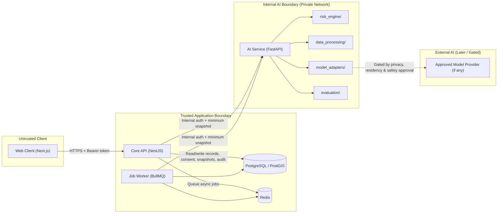

# Albo AI architecture

**Status:** Proposed — requires AI, architecture, security, and clinical-governance approval  
**Owner:** Artificial intelligence and architecture (shared / collaborator-led)  
**Related:** [Risk scoring](RISK_SCORING.md), [AI assistant](AI_ASSISTANT.md), [Model documentation](MODEL_DOCUMENTATION.md), [AI safety](AI_SAFETY.md), [Requirements](../01-project-foundation/REQUIREMENTS.md), [Project scope](../01-project-foundation/PROJECT_SCOPE.md), [Architecture](../02-architecture-and-engineering/ARCHITECTURE.md), [System design](../02-architecture-and-engineering/SYSTEM_DESIGN.md), [API documentation](../02-architecture-and-engineering/API_DOCUMENTATION.md), [Database schema](../02-architecture-and-engineering/DATABASE_SCHEMA.md), [Tech stack](../02-architecture-and-engineering/TECH_STACK.md), [Security](../03-security-and-privacy/SECURITY.md), [Data privacy](../03-security-and-privacy/DATA_PRIVACY.md)

## 1. Purpose and scope

This document defines the technical and governance boundaries of the Albo AI and analytics service (`ai-services/`). It translates the AI boundary rules already established in the requirements, architecture, system design, API, and security documents into one reviewable contract for the Python/FastAPI service.

It covers:

- The strict boundary between the NestJS core API and the Python/FastAPI AI service
- Internal structure and responsibilities of the AI service
- Progressive evolution from deterministic rules to validated machine-learning models
- The internal service-to-service request and response contract
- Synchronous versus asynchronous execution patterns
- Data minimization, provenance, reproducibility, and observability rules

It does not select final risk use cases, approve specific scoring formulas, choose an external LLM provider, or authorize training models on user data. Those remain open decisions or belong to future phases. Anything marked `Proposed` or `To validate` must not be implemented as approved functionality until accepted and recorded in [DECISIONS.md](../06-technical-decisions/DECISIONS.md).

## 2. Core AI architectural principles

1. **The AI service is specialized computation, not a second backend.** The NestJS core API owns identity, authentication, authorization, consent, provider assignments, durable application workflows, and client-facing persistence (ARCHITECTURE §2, §9; AGENTS.md Rule 3).
2. **Rules and weighted scoring first.** The first engineering release uses deterministic, explainable, versioned rules and weighted scoring. Machine-learning models are introduced only in a later phase after data quality, clinical validation, representative evaluation, fairness review, monitoring, and rollback gates are met (FR-016, FR-020, AI-006, ROADMAP §4).
3. **No proprietary LLM training.** Albo does not train or operate a proprietary large language model (PROJECT_SCOPE §4, TECH_STACK §5).
4. **Minimum necessary authorized input.** Requests to the AI service contain only the minimum authorized input snapshot required for the specific use case and version, after the core API has already verified consent and permissions (AI-002, API §9).
5. **Reproducibility by design.** Given the same immutable input snapshot and rule/model version, a risk calculation must produce a reproducible output for audit and evaluation (FR-019, DATABASE_SCHEMA §8.3).
6. **Non-diagnostic outputs only.** Every output is structured as a preventive indicator or bounded guidance with explicit contributing factors, limitations, provenance, and next steps—never as a confirmed medical diagnosis or prescription (FR-013, FR-014, AI-003, AI-004).
7. **Fail safely on missing or degraded data.** When required inputs are missing, stale, invalid, or a dependency fails, the AI service returns a `limited` or `failed` status—never a fabricated or falsely reassuring low-risk conclusion (FR-018, NFR-005, SYSTEM_DESIGN §8).
8. **Zero raw-prompt or health-record logging.** Logs, metrics, and traces record versions, latencies, and statuses without exposing raw health inputs, precise locations, or unrestricted prompts and assistant responses (DP-008, NFR-015, AGENTS.md Rule 12).

## 3. System boundary and ownership split



### 3.1 Explicit responsibility matrix

| Concern | Core API (NestJS) | AI Service (Python / FastAPI) |
|---|---|---|
| End-user authentication and token validation | **Owns** | Prohibited |
| Role, assignment, ownership, and consent checks | **Owns** | Prohibited (receives verified context metadata only) |
| Selecting valid, fresh, authorized inputs | **Owns** | Validates payload schema and completeness against use-case rules |
| Creating and storing `input_snapshot` and `risk_assessment` | **Owns** | Returns structured computation output to core API |
| Executing versioned risk rules, weighted scores, and feature transforms | Calls AI service | **Owns** |
| Assistant prompt assembly, input/output safety filters, escalation signal detection | Enforces route auth, rate limits, and escalation routing | **Owns** AI processing and structured safety classification (with core API gate) |
| Direct access to public client-facing database tables | **Owns** | Prohibited (ARCHITECTURE §9, API §9) |
| Audit event persistence | **Owns** | Returns provenance and version metadata for the core API to audit |
| External weather/map/facility ingestion | **Owns** (via backend adapters) | Consumes normalized environmental values passed in the input snapshot |

## 4. Internal AI service layout

Following the target repository structure in SYSTEM_DESIGN §4 (`ai-services/`), the FastAPI application is organized into four internal packages plus shared contract and safety layers:

```text
ai-services/
  app/
    main.py              FastAPI entrypoint, health checks, internal auth middleware
    contracts/           Typed Pydantic request/response schemas and version enums
    safety/              Input/output guardrails, non-diagnostic enforcement, escalation detectors
  risk_engine/           Deterministic rules, weighted scoring, threshold evaluation, factor extraction
  data_processing/       Input normalization, unit verification, freshness/completeness checks
  model_adapters/        Uniform interface for approved rule runners, future ML artifacts, or gated LLM adapters
  evaluation/            Offline test harnesses, synthetic benchmark runners, reproducibility and regression checks
  tests/                 Pytest unit, contract, safety, and evaluation tests
```

### 4.1 Package responsibilities

- **`contracts/`**: Defines strict Pydantic models for every internal endpoint. Rejects unknown fields, unapproved use-case codes, or missing provenance metadata before computation starts.
- **`data_processing/`**: Verifies that every required input field for the requested `use_case` and `rule_model_version` is present, within valid physiological or environmental bounds, and within its freshness window. Flags missing or stale fields so the engine can return `limited` rather than guessing.
- **`risk_engine/`**: Executes approved, version-pinned rule sets and weighted formulas (detailed in [RISK_SCORING.md](RISK_SCORING.md)). Produces the risk level, ordered contributing factors, mandatory limitation statements, and approved preventive next steps.
- **`model_adapters/`**: Isolates any future scikit-learn/XGBoost model artifact or approved assistant model behind a strict interface (detailed in [AI_ASSISTANT.md](AI_ASSISTANT.md) and [MODEL_DOCUMENTATION.md](MODEL_DOCUMENTATION.md)). Ensures external or statistical models cannot bypass output schemas or safety filters.
- **`safety/`**: Runs deterministic pre- and post-processing checks (detailed in [AI_SAFETY.md](AI_SAFETY.md)), including severe-symptom and self-harm signal detection (FR-024) and prohibited-claim filtering (diagnoses, prescriptions, certainty claims).
- **`evaluation/`**: Runs automated checks against versioned synthetic datasets in CI and pre-release validation (AI-005, TECH_STACK §10).

## 5. Phased AI evolution strategy

Albo's AI architecture is designed so the internal service contract remains stable while implementation matures through three strict gates:

| Phase | Capability | Allowed implementation | Entry / exit gate |
|---|---|---|---|
| **Phase 1: First release (Rules first)** | Single vertical slice and initial approved risk use cases | Deterministic rules and weighted scoring in `risk_engine/`; no predictive ML models in production | Clinical/domain review of rules, 100% reproducible outputs on synthetic test sets, safety and limitation wording verified (FR-016 to FR-019) |
| **Phase 2: Gated assistant & expanded rules** | Preventive-health Q&A, output explanation, and structured wellbeing check-in support | Approved assistant adapter with strict context bounding, input/output filters, and deterministic emergency/self-harm escalation | Escalation procedure approved (FR-024), privacy and data-residency review of any model provider ([DATA_PRIVACY.md](../03-security-and-privacy/DATA_PRIVACY.md) §12), adversarial safety evaluation passed (AI-005) |
| **Phase 3: Validated ML models (`Later`)** | Statistical or machine-learning risk prediction (e.g., scikit-learn, XGBoost) | Versioned model artifacts loaded via `model_adapters/` alongside rule baselines | Representative evaluation data, clinical validation, calibration, subgroup fairness review, drift monitoring, and instant rollback to rules (FR-020, AI-006) |

> [!IMPORTANT]
> No phase automatically unlocks the next. Introducing a machine-learning model or an external LLM provider requires an explicit approval record in [DECISIONS.md](../06-technical-decisions/DECISIONS.md) and a completed entry in [MODEL_DOCUMENTATION.md](MODEL_DOCUMENTATION.md).

## 6. Internal service-to-service contract

The AI service is deployed on a private network and is never reachable directly from the browser or public internet ([SECURITY.md](../03-security-and-privacy/SECURITY.md) §4, §9; [THREAT_MODEL.md](../03-security-and-privacy/THREAT_MODEL.md) §6.2).

### 6.1 Authentication and transport

- All calls originate from the NestJS core API or its authorized background worker.
- Every request must include:
  - Service-to-service authentication (proposed: signed service token or mutual TLS, open decision in [SECURITY.md](../03-security-and-privacy/SECURITY.md) §20)
  - `X-Request-Id` and trace correlation headers
  - Explicit client timeout enforced by the caller
- Requests without valid service identity are rejected with `401`/`403` and logged as a security signal (T-013).

### 6.2 Proposed internal endpoints

| Method | Internal path | Purpose | Consumer |
|---|---|---|---|
| `GET` | `/internal/v1/health` | Liveness and readiness check, loaded rule/model versions | Core API / orchestrator |
| `POST` | `/internal/v1/risk-assessments/calculate` | Execute a versioned risk calculation on an immutable input snapshot | Core API or `risk-assessment` job worker |
| `POST` | `/internal/v1/assistant/respond` | Process an approved assistant turn with safety and escalation checks (`Should` / safety-gated) | Core API assistant module |
| `POST` | `/internal/v1/check-ins/evaluate-safety` | Run deterministic safety/escalation screening on a structured wellbeing check-in | Core API check-in module |

### 6.3 Risk calculation request contract (Proposed)

Aligning with ARCHITECTURE §9 and API §9:

```json
{
  "request_id": "req-opaque-id",
  "use_case_code": "approved_use_case_code",
  "rule_model_version": "rules-v1.0.0",
  "input_snapshot_id": "snap-opaque-id",
  "calculated_for_timestamp": "2026-11-18T12:00:00Z",
  "authorization_context": {
    "consent_verified": true,
    "consent_purpose_code": "preventive_risk_calculation",
    "consent_version": "v1"
  },
  "inputs": {
    "health_inputs": [
      {
        "field_code": "approved_field_code",
        "value": 1,
        "unit": "approved_unit",
        "observed_at": "2026-11-18T08:00:00Z",
        "source_type": "self_reported"
      }
    ],
    "environmental_observations": [
      {
        "observation_type": "rainfall",
        "value": 42.5,
        "unit": "mm",
        "observed_at": "2026-11-18T06:00:00Z",
        "quality_status": "verified"
      }
    ]
  }
}
```

Notice what is **excluded** from the payload:

- No user name, email, phone number, national ID, or identity-provider subject ID
- No precise GPS coordinates (environmental observations are already normalized by the core API to the approved area/grid level)
- No unrelated historical records outside the use case's required inputs

### 6.4 Risk calculation response contract (Proposed)

```json
{
  "request_id": "req-opaque-id",
  "input_snapshot_id": "snap-opaque-id",
  "use_case_code": "approved_use_case_code",
  "rule_model_version": "rules-v1.0.0",
  "implementation_type": "rule",
  "status": "complete",
  "calculated_at": "2026-11-18T12:00:01Z",
  "result": {
    "level": "moderate",
    "score_band_or_weight_summary": "moderate_threshold_met",
    "contributing_factors": [
      {
        "factor_code": "recent_heavy_rainfall_exposure",
        "source_field": "rainfall",
        "direction": "increases_risk",
        "explanation_key": "factor.rainfall.elevated"
      }
    ],
    "limitations": [
      "This is a preventive risk indicator based on self-reported and regional environmental data, not a medical diagnosis."
    ],
    "recommended_next_steps": [
      {
        "action_code": "review_preventive_guidance",
        "priority": "standard"
      }
    ]
  },
  "safety_metadata": {
    "non_diagnostic_verified": true,
    "escalation_required": false,
    "missing_or_stale_fields": []
  }
}
```

When required inputs are missing, stale, or fail validation, the AI service returns `"status": "limited"`, omits or sets `"level": null`, populates `missing_or_stale_fields` and `limitations`, and never defaults to `"level": "low"` (FR-018, T-037).

## 7. Synchronous versus asynchronous execution

Following ARCHITECTURE §8 and SYSTEM_DESIGN §8:

- **Synchronous path (candidate for first vertical slice):** Deterministic rule calculations with bounded in-memory inputs and low latency may be called synchronously by the core API during `POST /api/v1/me/risk-assessments`, subject to a strict timeout.
- **Asynchronous path (BullMQ worker):** Batch recalculations, calculations triggered by environmental ingestion, or higher-latency model evaluations run asynchronously through the `risk-assessment` queue:
  1. Core API validates consent, creates the immutable `input_snapshot` and a `risk_assessment` record in `queued` status, and enqueues the job.
  2. Job worker re-verifies that consent has not been withdrawn ([ACCESS_CONTROL.md](../03-security-and-privacy/ACCESS_CONTROL.md) §8.1), marks status `processing`, and calls the AI service.
  3. Core API / worker validates the response and transitions the assessment to `complete`, `limited`, or `failed`.
- The AI service itself remains **stateless** across requests so workers and API instances can call it idempotently.

## 8. State, versioning, and configuration management

- **Stateless compute:** The AI service does not maintain its own primary database of user health records.
- **Immutable rule and model versions:** Every rule set and future model artifact has an immutable semantic version (e.g., `rules-v1.0.0`) matching a record in the core database's `rule_model_version` table (DATABASE_SCHEMA §8.2).
- **No silent live edits:** Changing a threshold, weight, prompt template, or escalation keyword creates a new version that must pass evaluation tests in CI before deployment (T-038).
- **Rollback:** The AI service supports keeping the previous approved rule/model version loaded so the core API can pin or roll back a use case via configuration without corrupting historical assessments.
- **Experiment tracking (`Later`):** MLflow or an equivalent registry is introduced only when Phase 3 model experiments are approved (TECH_STACK §5) and must never store real patient data.

## 9. Failure modes and degraded behavior

| Failure scenario | AI service behavior | Core API user-facing behavior |
|---|---|---|
| Required input field missing, out of range, or older than freshness threshold | Return `status: "limited"`, `level: null`, list missing/stale fields and limitation statement | Store `limited` assessment; show neutral "No current indicator available" state explaining what data is needed (UI_UX §6) |
| Unknown `use_case_code` or retired/unapproved `rule_model_version` | Return structured `422` validation error | Log configuration error; return safe unavailable state |
| AI service timeout or unreachable | Connection timeout | Mark assessment `failed` or leave queued for bounded retry; show unavailable state, never infer low risk (SYSTEM_DESIGN §16) |
| Assistant model adapter unavailable or times out | Return structured dependency failure; deterministic safety screener still runs on input | If emergency/self-harm signal detected, show approved crisis/escalation guidance immediately; otherwise show assistant unavailable message |
| Output safety filter detects prohibited diagnostic or prescription claim | Block raw output; return safe fallback response and flag safety telemetry | Return safe bounded fallback; increment safety-filter alert metric |

## 10. Observability and privacy in the AI service

- **OpenTelemetry instrumentation:** Emit request count, latency histograms, and status counts tagged by `use_case_code`, `rule_model_version`, `implementation_type`, and `status` (`complete`, `limited`, `failed`) (TECH_STACK §12).
- **Strict log redaction:** FastAPI request/exception loggers must override default payload dumping so validation errors (such as Pydantic `ValidationError`) log only field names and error codes—never the rejected user health values or conversation strings (DP-008, T-017).
- **Safety metrics:** Count safety-filter triggers, `limited` assessment reasons, and emergency-escalation detections without logging the user's message content.

## 11. First-release AI architecture scope

Aligned with the first vertical slice in [PROJECT_STATUS.md](../PROJECT_STATUS.md) and SYSTEM_DESIGN §20:

- FastAPI service shell with `/internal/v1/health` and `/internal/v1/risk-assessments/calculate`
- Service-to-service authentication middleware and request-ID propagation
- Typed Pydantic contracts and redacted error handling
- `data_processing/` completeness, range, and freshness validator for the first approved vertical-slice use case
- `risk_engine/` deterministic rule runner for one approved non-diagnostic risk indicator
- Pytest suite covering contract validation, reproducibility, missing/stale input handling (`limited` status), and zero sensitive-payload logging

Excluded from the first vertical slice: assistant endpoints, external LLM providers, ML model training/inference, MLflow, and multi-disease batch pipelines.

## 12. Acceptance criteria

The AI architecture is ready for first-release implementation when:

- The internal request/response schema between NestJS and FastAPI is agreed.
- Service-to-service authentication between the core API and AI service is selected.
- Synchronous versus queued execution for the first vertical slice is decided.
- The first vertical-slice risk use case and rule version are specified in [RISK_SCORING.md](RISK_SCORING.md).
- Log redaction for Pydantic validation errors and unhandled exceptions is verified by tests.
- All decisions are recorded in [DECISIONS.md](../06-technical-decisions/DECISIONS.md).

## 13. Open AI architecture decisions

- Synchronous HTTP call versus BullMQ worker queue for the first vertical-slice risk calculation
- Service-to-service authentication mechanism between NestJS and FastAPI (shared signed token vs. mTLS)
- First-release risk use cases, input fields, and freshness thresholds
- Whether the AI assistant is included in the first release (`Should` requirement gated by safety review)
- Selection, hosting, and data-residency compliance of any external model provider if the assistant is enabled
- Localization approach for `explanation_key`, limitations, and next-step codes (whether translated in the core API or web client)
