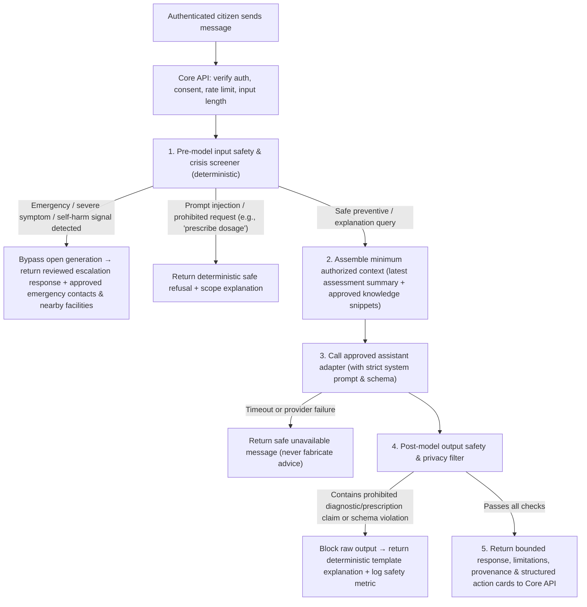

# Albo AI assistant

**Status:** Approved — safety-gated (`Should` requirement; runtime activation remains gated on `FR-024` escalation and `OPEN-006` / `OPEN-011`)  
**Owner:** Artificial intelligence and clinical/safety governance (shared / collaborator-led)  
**Related:** [AI architecture](AI_ARCHITECTURE.md), [Risk scoring](RISK_SCORING.md), [Model documentation](MODEL_DOCUMENTATION.md), [AI safety](AI_SAFETY.md), [Requirements](../01-project-foundation/REQUIREMENTS.md), [Project scope](../01-project-foundation/PROJECT_SCOPE.md), [System design](../02-architecture-and-engineering/SYSTEM_DESIGN.md), [API documentation](../02-architecture-and-engineering/API_DOCUMENTATION.md), [UI/UX](../02-architecture-and-engineering/UI_UX.md), [Data privacy](../03-security-and-privacy/DATA_PRIVACY.md), [Threat model](../03-security-and-privacy/THREAT_MODEL.md)

## 1. Purpose and scope

This document defines the behavioral, architectural, privacy, and safety contract for the Albo AI assistant (`/api/v1/assistant/conversations` in the core API and `/internal/v1/assistant/respond` in `ai-services/`).

The project proposal describes a conversational assistant that helps users reflect on wellness and lifestyle habits, explains health risk indicators in plain language, offers supportive preventive guidance when users feel stressed or overwhelmed, and surfaces nearby healthcare facilities when urgent care is needed.

To deliver this safely, the assistant is strictly bounded:

- It is a **`Should` capability gated by safety and escalation approval** (FR-021, FR-022, API §7, UI_UX §3). The dedicated mental-wellness hub remains a **`Later` phase capability** until its clinical-review, referral, and safety procedures are approved (FR-025, [PROJECT_SCOPE.md](../01-project-foundation/PROJECT_SCOPE.md) §5 Phase 2, [ROADMAP.md](../01-project-foundation/ROADMAP.md) §3 Phase 5).
- It is an informational and navigation support tool—**never a doctor, therapist, diagnostic instrument, or emergency service** (FR-023, PROJECT_OVERVIEW §3).
- Emergency, severe-symptom, and self-harm signals always follow a **deterministic, reviewed escalation flow** rather than relying on open-ended generative output (FR-024).

Anything marked `Proposed` or `To validate` must not be enabled in production until approved and recorded in [DECISIONS.md](../06-technical-decisions/DECISIONS.md).

## 2. Assistant principles

1. **Explicit AI identity and uncertainty.** The assistant always introduces itself as an AI support tool, states its limitations, and communicates uncertainty rather than claiming clinical authority (FR-023, UI_UX §8).
2. **Explain, do not invent.** When explaining a user's risk indicator or trend, the assistant uses only the structured assessment, contributing factors, limitations, and approved guidance passed in the authorized context—never inventing hidden medical causes or overriding the rule engine (FR-022, SYSTEM_DESIGN §11).
3. **Deterministic escalation first.** Every user turn is screened by deterministic emergency, severe-symptom, and self-harm detectors *before* and *independently of* any generative model call (FR-024, T-041).
4. **Caller-scoped context only.** The assistant receives only the authenticated caller's minimum authorized context for the current turn. Cross-user data is physically absent from the request payload, preventing cross-user leakage even under prompt injection (AI-002, T-040).
5. **No proprietary LLM training.** Albo does not train a proprietary large language model or allow external model providers to train on user conversations (PROJECT_SCOPE §4, [DATA_PRIVACY.md](../03-security-and-privacy/DATA_PRIVACY.md) §6).
6. **Minimal conversation retention.** Stored conversation metadata is minimized and governed by explicit consent and retention limits (API §8.7, [DATA_PRIVACY.md](../03-security-and-privacy/DATA_PRIVACY.md) §8).

## 3. Permitted vs. prohibited assistant capabilities

| Capability | Status | Rule |
|---|---|---|
| Explain an existing Albo risk assessment (`level`, `contributing_factors`, `limitations`, `recommended_next_steps`) in plain language | Permitted (`Should`, FR-022) | Must cite the assessment timestamp and rule version; cannot change the calculated level |
| Answer general preventive-health and lifestyle questions from approved public-health guidance | Permitted (`Should`, FR-021) | Grounded in approved guidance only; includes non-diagnostic disclaimer |
| Guide the user through a structured wellbeing or lifestyle check-in | Permitted (`Should`) | Uses versioned, approved questionnaire prompts (`questionnaire_version`); responses feed structured records only with consent |
| Surface approved nearby facilities or emergency contact information when risk is high or urgent symptoms are mentioned | Permitted (`Must` on escalation, FR-024, FR-026) | Facility cards come from the core API's verified facility catalog, never hallucinated by a language model |
| Diagnose a disease, interpret lab results, or confirm/rule out a condition | **Prohibited** (FR-023, AI-004) | Refused immediately with safe non-diagnostic redirection |
| Prescribe, recommend, or adjust medication or clinical treatment | **Prohibited** (FR-014, FR-023) | Refused immediately; directs user to a qualified healthcare provider |
| Provide open-ended psychotherapy or act as a crisis counselor during self-harm/emergency situations | **Prohibited** (FR-024, FR-025) | Immediately triggers the reviewed escalation response with emergency/crisis resources and nearby care |
| Access, summarize, or compare another person's records | **Prohibited** (FR-022, T-040) | Enforced by core API authorization and single-user payload isolation |

## 4. End-to-end conversation and safety flow

## 5. Context assembly and data minimization

To satisfy AI-002 and [DATA_PRIVACY.md](../03-security-and-privacy/DATA_PRIVACY.md) §6, §11:

### 5.1 What the Core API sends to `/internal/v1/assistant/respond`

- `request_id` and `conversation_id` (opaque UUIDs)
- `authorization_context`: confirmation that the user granted the `assistant_conversations` consent purpose
- `user_message`: bounded length (e.g., max 1,000 characters), stripped of control characters
- `conversation_window`: at most the last $N$ turns (proposed: $N \le 5$) of the current session, or a structured state summary
- `authorized_context_snapshot`:
  - Only the structured summary of the risk assessment or check-in the user is asking about (`use_case_code`, `level`, `contributing_factors`, `limitations`, `recommended_next_steps`, `calculated_at`)
  - Approved, pre-retrieved facility summaries if facility navigation was requested
  - Approved preventive-health knowledge snippets relevant to the topic

### 5.2 What is never sent to the assistant adapter

- User name, email, phone number, national ID, date of birth, or exact home address
- Precise GPS coordinates (core API resolves any facility lookup first and passes only approved facility summaries)
- Full historical health-input tables or other users' data
- Credentials, tokens, or internal database identifiers

## 6. Grounding and hallucination prevention

1. **Structured tool/card separation:** The language model adapter never generates facility names, phone numbers, addresses, map coordinates, or risk scores from its own weights. Instead, it selects a structured intent or `action_code` (for example, `show_nearby_facilities` or `explain_assessment`), and the core API attaches verified facility records or stored assessment data.
2. **Curated preventive knowledge base:** General preventive-health explanations must be grounded in a versioned, clinically reviewed set of public-health reference snippets (e.g., WHO and Rwanda Biomedical Centre preventive guidance) rather than unconstrained open-domain generation.
3. **Structured output contract:** The internal assistant response uses a strict JSON schema:
   - `response_type`: `"explanation"`, `"preventive_guidance"`, `"check_in_prompt"`, `"refusal"`, `"escalation"`, or `"unavailable"`
   - `message_text`: Bounded plain-language response
   - `disclaimer`: Mandatory visible reminder that the assistant is an AI support tool and not a medical provider
   - `referenced_assessment_id` and `rule_model_version` (when explaining a result)
   - `suggested_actions`: Allowlisted UI action codes (e.g., `view_facilities`, `view_risk_detail`, `contact_emergency_support`)
   - `safety_metadata`: Flags indicating whether input/output filters or escalation rules triggered

## 7. Emergency, severe-symptom, and self-harm escalation (FR-024)

The proposal notes that the assistant should help users facing stress or emotional exhaustion and show nearest health facilities when conditions are acute. Under FR-024 and [AI_SAFETY.md](AI_SAFETY.md), this is governed by a strict rule:

- **Two-layer detection:**
  1. Deterministic pattern, keyword, and structured check-in threshold detector (runs in milliseconds, works even if an external LLM is offline).
  2. Classifier check on ambiguous distress expressions.
- **Conservative bias (favor false positives over false negatives):** If a message plausibly indicates intentional self-harm, suicidal ideation, chest pain, severe breathing difficulty, Loss of consciousness, high fever with danger signs, or acute medical crisis, the system immediately takes the escalation path (T-041).
- **Escalation response behavior:**
  - Stops normal conversational generation.
  - Displays a calm, pre-approved, clinically reviewed crisis and emergency support message with national/local emergency numbers and crisis hotlines in Rwanda (exact numbers and referral procedure to be validated before launch — REQUIREMENTS §9).
  - Surfaces verified nearby emergency healthcare facilities via the core API facility service.
  - Does **not** attempt autonomous crisis therapy or probe for sensitive trauma details.

## 8. Prompt-injection and abuse defenses (T-040)

- **Instruction hierarchy:** System instructions and approved guidance snippets are separated from untrusted `user_message` text.
- **No privileged agency:** The assistant has **no write capability**—it cannot modify health inputs, change risk levels, alter consent, query the database directly, call arbitrary external URLs, or trigger provider actions.
- **Output validation:** Even if a prompt-injection attempt convinces the underlying model to output diagnostic language, system prompt text, or malformed JSON, the deterministic post-processing filter (`ai-services/app/safety/`) blocks the response and substitutes a safe refusal template.
- **Rate limiting:** Assistant message endpoints enforce strict per-user and per-session rate limits and daily quotas (API §10, T-011).

## 9. Implementation options and vendor governance

In accordance with TECH_STACK §5, §13, and §16:

- **Stage 1 (Template & guided explanation assistant):** Uses deterministic intent routing and pre-reviewed explanation templates populated from the user's structured assessment and approved knowledge base. Requires zero external LLM data transfer and can run completely in-house.
- **Stage 2 (Gated LLM-backed conversational adapter):** Connects `model_adapters/` to an approved language model only after:
  1. Zero-data-retention / no-training contractual guarantee is verified.
  2. Data residency compliance under Rwanda Law N° 058/2021 is confirmed ([DATA_PRIVACY.md](../03-security-and-privacy/DATA_PRIVACY.md) §12).
  3. The adversarial safety evaluation suite in [AI_SAFETY.md](AI_SAFETY.md) passes 100% of crisis-escalation and non-diagnostic boundary tests.

## 10. First-release position

Aligned with [PROJECT_STATUS.md](../PROJECT_STATUS.md), PROJECT_SCOPE §3, SYSTEM_DESIGN §20, and [ADR-017](../06-technical-decisions/DECISIONS.md):

- The **first vertical slice** excludes the conversational assistant so the team can validate authentication, consent, health-input provenance, deterministic risk scoring, and explanation contracts first.
- The assistant endpoints (`/api/v1/assistant/conversations` and `/messages`) are gated behind the `FEATURE_ASSISTANT_ENABLED` runtime circuit breaker (defaulting to `false` in `production` while testable on synthetic fixtures in `development`/`test` per `ADR-017`) until the emergency/self-harm escalation procedure (FR-024, `OPEN-006`), clinical wording review, and privacy/vendor review (`OPEN-011`) are approved.

## 11. Acceptance criteria

The AI assistant is ready to be enabled when:

- The emergency, severe-symptom, and self-harm escalation procedure and Rwanda crisis contact directory are approved by clinical/health stakeholders (FR-024).
- The conversation consent purpose, retention window, and deletion behavior are approved ([DATA_PRIVACY.md](../03-security-and-privacy/DATA_PRIVACY.md)).
- The model adapter choice (deterministic/template vs. external LLM provider) and its data-residency compliance are approved and recorded in [MODEL_DOCUMENTATION.md](MODEL_DOCUMENTATION.md) and [DECISIONS.md](../06-technical-decisions/DECISIONS.md).
- Automated evaluation tests verify 100% recall on the mandatory emergency/self-harm test set and zero diagnostic/prescription violations on the adversarial test set ([AI_SAFETY.md](AI_SAFETY.md)).

## 12. Open assistant decisions

- Whether the first public release includes the assistant (`Should`) or defers it to the first post-MVP update
- Choice between an in-house template/retrieval assistant vs. an external LLM API for the initial assistant launch
- Approved Rwanda emergency, ambulance, and mental-health crisis contact details for the escalation card
- Exact retention period for assistant conversations (or whether conversations are ephemeral by default)
- Supported languages for assistant interactions and crisis detection (e.g., English, Kinyarwanda, French)
