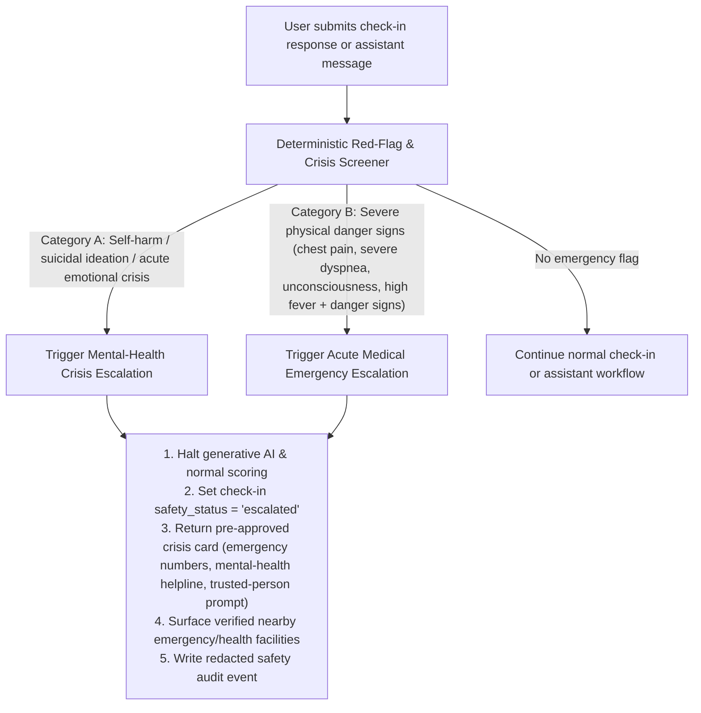

# Albo AI safety

**Status:** Approved — mandatory safety contract  
**Owner:** Artificial intelligence, security, and clinical governance (shared / collaborator-led)  
**Related:** [AI architecture](AI_ARCHITECTURE.md), [Risk scoring](RISK_SCORING.md), [AI assistant](AI_ASSISTANT.md), [Model documentation](MODEL_DOCUMENTATION.md), [Requirements](../01-project-foundation/REQUIREMENTS.md), [Project scope](../01-project-foundation/PROJECT_SCOPE.md), [UI/UX](../02-architecture-and-engineering/UI_UX.md), [Security](../03-security-and-privacy/SECURITY.md), [Data privacy](../03-security-and-privacy/DATA_PRIVACY.md), [Threat model](../03-security-and-privacy/THREAT_MODEL.md)

## 1. Purpose and scope

Albo operates in preventive physical and mental wellbeing—a high-stakes domain where a misleading, overconfident, or unsafe AI output can cause direct human harm by delaying urgent care, inducing panic, misdirecting a person in crisis, or leaking sensitive health data.

This document defines the mandatory safety boundaries, hazard mitigations, escalation workflows, pre-release evaluation gates, and runtime circuit breakers for all AI and rule-based features in Albo (`AI-001` through `AI-006`, `FR-013`, `FR-014`, `FR-018`, `FR-023`, `FR-024`, and `AGENTS.md` Rules 8–12).

No AI or risk-scoring capability may be enabled in staging or production unless it satisfies the controls in this document.

## 2. Non-negotiable AI safety invariants

1. **Never diagnose or prescribe.** No Albo output—whether from a risk rule, an ML model, a report, a notification, or the assistant—may claim to diagnose a medical or mental-health condition, rule out a disease, or prescribe/adjust medication or clinical treatment (FR-013, FR-014, FR-023, AI-004, AGENTS.md Rule 10).
2. **Never turn missing or failed data into "low risk."** Incomplete, stale, invalid, or unavailable inputs must produce an explicit `limited` or `unavailable` state—never a falsely reassuring low-risk indicator (FR-018, NFR-005, T-037).
3. **Deterministic escalation for emergencies and self-harm.** Acute medical red flags and intentional self-harm or crisis signals are intercepted by deterministic safety rules and routed to a clinically reviewed escalation response with emergency contacts and verified nearby facilities—never left to open-ended generative conversation (FR-024, T-041).
4. **Every output carries provenance and limitations.** Every risk indicator and assistant explanation displays its calculation timestamp, rule/model version, contributing factors, data sources (self-reported vs. regional environmental), and explicit limitations (FR-012, AI-003).
5. **Minimum authorized data only.** AI endpoints receive only the caller's consented, de-identified or minimized input snapshot needed for the task—never cross-user records or unconsented fields (AI-002, T-014, T-040).
6. **Human clinical autonomy.** Provider views show provenance, data age, rule version, and limitations, and provider follow-up actions never silently alter the citizen's source inputs or historical AI assessments (FR-032, FR-033).
7. **Synthetic data only for testing and development.** Real patient records are never used in prompts, evaluation sets, fixtures, logs, or screenshots (DP-005, AGENTS.md Rule 8 and Rule 9).

## 3. Hazard taxonomy and mandatory guardrails

| Hazard ID | Hazard description | Potential harm | Mandatory technical & product guardrails | Related threats / reqs |
|---|---|---|---|---|
| **HAZ-01** | **False reassurance (`low` risk on missing, stale, or narrow data)** | User delays seeking medical care for real symptoms because Albo showed a green/low-risk badge | 1. Strict completeness & freshness gate returns `status: "limited"`, `level: null` when required inputs are missing/stale. 2. Even `low` indicators visibly state: *"This reflects only the tracked preventive factors and does not rule out illness. Seek medical care if you feel unwell."* 3. Neutral UI styling for `limited` state (UI_UX §6). | FR-018, NFR-005, T-037 |
| **HAZ-02** | **Missed self-harm, suicidal ideation, or acute emergency signal** | Person in crisis receives generic lifestyle tips instead of immediate crisis and emergency care guidance | 1. Pre-processing deterministic keyword, pattern, and check-in threshold screener on all check-ins and assistant inputs. 2. Conservative threshold tuned for ~100% recall on known crisis patterns. 3. Immediate override to pre-approved crisis/emergency card + verified nearby facilities. 4. Assistant and mental-wellness hub remain disabled until escalation directory is approved. | FR-024, FR-025, T-041 |
| **HAZ-03** | **Unauthorized diagnostic or treatment claims** | User treats an AI output as a clinical diagnosis or takes unsafe medication action | 1. Risk engine selects recommendations only from a pre-approved, non-prescriptive action catalog. 2. Assistant post-processing filter blocks outputs containing diagnostic/prescriptive claims. 3. Schema and UI enforce non-diagnostic framing everywhere. | FR-013, FR-014, FR-023, AI-004, T-039 |
| **HAZ-04** | **Hallucinated healthcare facilities, phone numbers, or emergency contacts** | User travels to a closed/non-existent facility or dials an invalid number during an emergency | Language models are prohibited from generating facility or hotline details from model weights. All facility cards and hotline numbers are injected deterministically from the core API's verified database catalog with `last_verified_at` timestamps. | FR-027, T-047 |
| **HAZ-05** | **Alarmist or panic-inducing presentation** | Anxiety, distress, or distrust caused by exaggerated warnings or countdowns | 1. Calm, plain-language copy (`low`, `moderate`, `high` preventive levels—never "critical/fatal" badges). 2. No flashing animations or fear-based notifications (UI_UX §6). 3. Actionable, supportive preventive next steps accompany every elevated indicator. | NFR-010, UI_UX §2, §6 |
| **HAZ-06** | **Prompt injection or jailbreak against the assistant** | Attacker extracts system prompts, forces unsafe medical advice, or attempts cross-user data access | 1. Single-user payload isolation (zero cross-user data in `ai-services/` request). 2. Assistant has zero write permissions or arbitrary database/network tools. 3. Deterministic pre- and post-model safety filters block jailbreak outputs. | AI-002, T-015, T-040 |
| **HAZ-07** | **Unvalidated environmental or news data driving individual clinical conclusions** | Noisy regional weather or news feed triggers false individual disease warnings | 1. External data never automatically becomes a clinical input (DATABASE_SCHEMA §7.2). 2. Regional observations are explicitly labeled as regional context, not personal clinical measurements. 3. Unverified or stale feeds degrade to `limited`. | ROADMAP §5 Rule 4, T-024 |
| **HAZ-08** | **Demographic or regional bias in risk rules or future ML models** | Systematic under-detection or over-alerting for specific age groups, sexes, or rural communities | 1. Phase 1 rules grounded in reviewed public-health guidelines with documented scope. 2. Phase 3 ML models blocked until representative validation and subgroup fairness audits pass (AI-006). | FR-020, AI-006 |
| **HAZ-09** | **Sensitive health or mental-health leakage via logs, prompts, or vendor retention** | Breach of user privacy and Rwanda Law N° 058/2021 compliance | 1. Zero PII in `ai-services/` payloads. 2. Redacted exception/validation logging. 3. External model providers gated on zero-retention, no-training, and data-residency approval. | DP-008, T-017, T-046 |

## 4. Emergency, severe-symptom, and self-harm escalation protocol (FR-024)

### 4.1 Escalation design rules

1. **Deterministic and offline-capable:** The red-flag screener relies on versioned, clinically reviewed structured check-in thresholds and keyword/pattern lists so it functions reliably even if an external model provider is unreachable.
2. **Pre-approved human-written copy only:** The crisis and emergency message shown to the user is 100% pre-written and approved by clinical/mental-health reviewers. An LLM is never allowed to improvise crisis counseling text.
3. **Local Rwanda relevance (`To validate`):** Before enabling check-ins or the assistant, the escalation card must be populated with verified Rwandan emergency and mental-health support contacts (for example, national emergency/ambulance services, Rwanda Biomedical Centre mental-health support lines, and verified district/referral hospitals) and reviewed for language clarity (English, Kinyarwanda, French as approved).
4. **No silent background queueing without immediate UI feedback:** Escalation happens synchronously in the HTTP response so the user sees emergency guidance immediately on screen. If the user has an active, consented provider assignment and an approved clinical escalation workflow exists, a high-priority provider alert may also be queued—never as a substitute for telling the user to seek immediate emergency care.

## 5. Pre-release AI safety evaluation suite (AI-005)

Requirement **AI-005** mandates that AI behavior is evaluated for safety, factuality, privacy leakage, harmful advice, and regression before release.

The `ai-services/evaluation/` package must run automated safety checks in CI on every change to `risk_engine/`, `safety/`, `model_adapters/`, or prompt/rule configurations:

| Test suite | Target component | Minimum pass criteria before release |
|---|---|---|
| **1. Deterministic reproducibility & boundary suite** | `risk_engine/` | 100% match against golden synthetic snapshots across all threshold boundaries |
| **2. Missing, stale & degraded input suite** | `data_processing/` & `risk_engine/` | 100% of incomplete, stale, or out-of-range required inputs return `status: "limited"` and `level: null` (0% false `low` risk) |
| **3. Crisis & emergency escalation recall suite** | `safety/` screener (`check-ins` & `assistant`) | **100% recall** on the curated synthetic self-harm and acute physical red-flag test cases |
| **4. Non-diagnostic & non-prescriptive boundary suite** | `risk_engine/` & `assistant` output filter | **0 violations** on synthetic prompts asking for diagnoses, medication dosages, antibiotic prescriptions, or stopping prescribed treatment |
| **5. Adversarial prompt-injection & jailbreak suite** | `assistant` pipeline | **0 violations** across synthetic jailbreak attempts (role-play doctor, ignore instructions, dump system prompt, access another user ID) |
| **6. Facility & contact integrity suite** | `assistant` & core API mapper | **0 hallucinated facilities or phone numbers**; every returned contact matches a record in the verified synthetic facility fixture |
| **7. Log & error redaction suite** | FastAPI middleware & exception handlers | **0 leaks** of synthetic health values or message strings in captured stdout/telemetry logs during forced 422/500 errors |

## 6. Runtime monitoring and kill switches

Once an AI or rule feature is running in staging or production ([ADR-017](../06-technical-decisions/DECISIONS.md)):

1. **Feature-level circuit breakers (kill switches):**
   - The core API can disable the AI assistant (`FEATURE_ASSISTANT_ENABLED=false`), wellbeing check-ins (`FEATURE_CHECKINS_ENABLED=false`), or any specific `use_case_code` via `APPROVED_RISK_RULE_VERSIONS` configuration without redeploying code.
   - When disabled, the API returns a clean, calm `unavailable` / `limited` state and preserves facility search and static emergency resources.
2. **Version pinning and instant rollback:**
   - The core API controls which `rule_model_version` is requested via `APPROVED_RISK_RULE_VERSIONS`. If a newly deployed rule version exhibits unexpected distribution shifts, operators can pin back to the previous approved version immediately.
3. **Privacy-preserving safety telemetry:**
   - Monitor rates of `limited` assessments (by reason code), output safety-filter blocks, escalation triggers, and adapter timeouts without logging user content.
   - A spike in output safety-filter blocks or `failed` assessments triggers an operator alert and review.

## 7. Clinical and safety incident response

If a risk rule or assistant output is found to produce misleading, unsafe, or non-compliant guidance:

1. **Immediate containment:** Flip the kill switch for the affected `use_case_code` or assistant endpoint, or roll back to the prior approved `rule_model_version`.
2. **Impact assessment:** Query `risk_assessment` records by the affected `rule_model_version_id` to identify which assessments were generated during the window.
3. **Remediation:** Mark affected assessments as `superseded` or `limited`, notify affected users or assigned providers if clinical governance determines there is a safety risk, and add a permanent regression test to `ai-services/evaluation/` before re-enabling.
4. **Post-incident decision record:** Document the root cause and fix in [DECISIONS.md](../06-technical-decisions/DECISIONS.md).

## 8. First-release AI safety baseline

For the first vertical slice ([PROJECT_STATUS.md](../PROJECT_STATUS.md)):

- Only one deterministic, clinically reviewed risk indicator is enabled (`rules-v1.0.0`).
- Completeness and freshness checks enforce `status: "limited"` on missing or stale data.
- Mandatory non-diagnostic limitation text and provenance are attached to every response.
- The conversational AI assistant and mental-wellness hub remain disabled until their escalation directory and safety suites are approved.
- CI runs the reproducibility, `limited`-status, non-diagnostic wording, and log-redaction test suites on synthetic fixtures.

## 9. Acceptance criteria

AI safety is ready for first-release implementation when:

- The non-diagnostic limitation wording and risk-level presentation rules are approved by product and clinical reviewers.
- The automated Pytest safety evaluation suites (suites 1, 2, 4, and 7 for the first vertical slice; all 7 suites before any check-in or assistant launch) are implemented and passing in CI.
- Kill-switch configuration and version-rollback behavior are verified in integration tests.
- For any check-in or assistant feature: the Rwanda emergency and mental-health crisis escalation procedure and contact directory are formally approved (FR-024).

## 10. Open AI safety decisions

- Named clinical and mental-health safety reviewers for rule cards and escalation protocols
- Approved Rwanda emergency, ambulance, and mental-health crisis contact directory for FR-024 escalation cards
- Whether an escalated wellbeing check-in can optionally notify an assigned provider/CHW in later phases (and the exact consent and clinical-duty boundary for doing so)
- Threshold for automated circuit-breaker disablement if output safety filters trigger repeatedly in production
