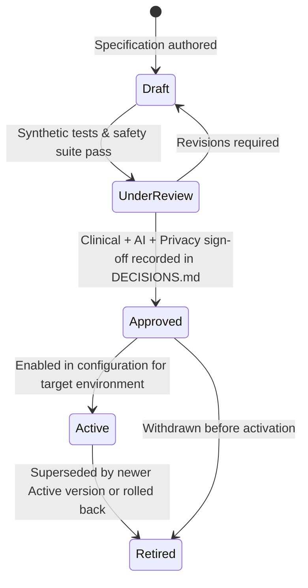

# Albo model documentation

**Status:** Proposed — registry template and governance contract; no production models or rule versions approved yet  
**Owner:** Artificial intelligence and clinical/domain governance (shared / collaborator-led)  
**Related:** [AI architecture](AI_ARCHITECTURE.md), [Risk scoring](RISK_SCORING.md), [AI assistant](AI_ASSISTANT.md), [AI safety](AI_SAFETY.md), [Requirements](../01-project-foundation/REQUIREMENTS.md), [Database schema](../02-architecture-and-engineering/DATABASE_SCHEMA.md), [Decisions](../06-technical-decisions/DECISIONS.md)

## 1. Purpose and scope

This document is the authoritative catalog and documentation standard ("model cards" and "rule cards") for every rule set, weighted scoring specification, assistant adapter, and future machine-learning model in Albo.

Requirement **AI-001** states:

> *AI features have a documented purpose, intended users, excluded uses, owner, version, and approval status.*

Requirement **DATABASE_SCHEMA §8.2** requires every derived assessment to reference an immutable `rule_model_version` record with its `implementation_type`, `approval_status`, `limitations`, and `evaluation_reference`.

This document defines:

1. The mandatory documentation card required before any rule version, assistant adapter, or ML model can be enabled
2. The lifecycle states and approval gates for versions
3. The initial candidate catalog for Albo's phased roadmap
4. Synthetic evaluation, fairness, calibration, monitoring, and retirement requirements

## 2. Governance rules

1. **No undocumented rule or model in code.** Every `rule_model_version` selectable by `ai-services/` must have a corresponding entry in this document (AI-001, AGENTS.md Rule 1 and Rule 4).
2. **Rules and models share the same registry discipline.** Phase 1 deterministic rule sets are documented with the same rigor as Phase 3 machine-learning models so provenance and limitations are explicit from day one (FR-017).
3. **Immutable versions.** Once a version (`rules-v1.0.0`, `model-v1.0.0`, `assistant-v1.0.0`) is marked `approved`, its logic, weights, thresholds, or prompt templates cannot be altered without creating a new version.
4. **No real patient data in documentation or evaluation artifacts.** All benchmark sets, example inputs, and test fixtures referenced here use 100% synthetic data (DP-005, AGENTS.md Rule 8 and Rule 9).
5. **Explicit rollback target.** Every active version beyond the initial release must identify the prior approved version (or safe `limited` disabled state) to roll back to if an error or safety regression is discovered.

## 3. Version lifecycle states

Aligning with `risk_use_case.status` and `rule_model_version.approval_status` in DATABASE_SCHEMA §8:



| State | Permitted environments | Allowed to serve real users? |
|---|---|---|
| `draft` | Local development, CI unit tests (synthetic data only) | **No** |
| `under_review` | Test / staging with synthetic data for clinical and safety review | **No** |
| `approved` / `active` | Production (once all release gates pass) | **Yes**, within documented `intended_use` |
| `retired` | Retained in metadata for historical reproducibility and audit only | **No** for new calculations |

## 4. Mandatory Rule / Model Card template

Every entry added to section 6 must complete all fields below before moving from `draft` to `approved`:

```markdown
### [Use-Case / Component Code] — `[version]`

- **Name:** Human-readable title
- **Implementation type:** `rule` | `weighted_score` | `assistant_adapter` | `ml_model`
- **Owner:** Engineering owner and clinical/domain reviewer
- **Approval status:** `draft` | `under_review` | `approved` | `retired`
- **Decision record:** Link to entry in `DECISIONS.md`
- **Effective from / Retired at:** ISO dates or `Not yet active`

#### 1. Intended use and users
- **Purpose:** What preventive indicator or support output this produces
- **Intended users:** e.g., authenticated adult citizens in the approved geography
- **Allowed decision scope:** Preventive awareness, lifestyle reflection, facility discovery

#### 2. Excluded and prohibited uses
- Explicit list of what the output must never be used for (clinical diagnosis, prescribing, emergency triage substitution, denial of care, insurance/employment scoring)

#### 3. Inputs and data provenance
- **Required inputs:** Field codes, units, allowed ranges, allowed sources, `max_age_hours`
- **Optional inputs:** Field codes and limitation message triggered when omitted
- **Excluded data:** Confirmation that direct PII and unapproved fields are excluded

#### 4. Logic, architecture, or specification summary
- **For rules / weighted scores:** Reference to published guidelines (e.g., WHO / RBC), exact factor thresholds, weights, floor rules, and level cutoffs (`low`, `moderate`, `high`)
- **For assistant adapters:** Base model/template identifier, context bounds, deterministic pre/post safety filters
- **For ML models (`Later`):** Algorithm, feature pipeline, training/validation data provenance (consented, de-identified, representative), calibration method

#### 5. Outputs and mandatory limitations
- Output schema version, allowed levels/types, required limitation strings, and next-step action codes

#### 6. Evaluation and safety evidence
- **Synthetic correctness & boundary suite:** Reference to `ai-services/evaluation/` test file
- **Reproducibility verification:** Confirmation of deterministic output across repeated runs
- **Safety & escalation verification:** Crisis recall and non-diagnostic boundary test results
- **Subgroup fairness & calibration (`Later` for ML models):** Performance across demographic and regional slices

#### 7. Monitoring, drift, and rollback
- Runtime metrics tracked, alert thresholds, and immediate rollback version or safe fallback (`status: "limited"`)
```

## 5. Additional requirements for Phase 3 machine-learning models (`Later`)

Under **FR-020** and **AI-006**, no statistical or machine-learning model (such as scikit-learn or XGBoost) may enter `under_review` or `approved` status without documenting:

1. **Data governance and consent:** Proof that training and validation datasets were collected under explicit consent or approved public-health data-sharing agreements, with ethics/IRB and Rwanda NCSA compliance verified.
2. **Population representativeness:** Analysis showing the training and evaluation distributions reflect the target Rwandan / regional user population across age, sex, urban/rural context, and seasonal patterns.
3. **Baseline comparison:** Evidence that the ML model provides a statistically and clinically meaningful improvement over the Phase 1 deterministic rule version without degrading explainability or safety.
4. **Calibration and uncertainty:** Verification that predicted probabilities or risk tiers are calibrated and that out-of-distribution inputs return `status: "limited"` rather than overconfident extrapolations.
5. **Subgroup fairness audit:** False-negative and false-positive comparison across demographic groups to ensure the model does not systematically under-warn vulnerable groups.
6. **Drift and performance monitoring:** Automated tracking of input feature distribution shifts and output level distributions (using privacy-preserving aggregates), with an automated or one-command rollback to the deterministic rule baseline.

## 6. Current candidate catalog

No rule or model version is approved for production yet. The table below registers the initial candidates mapped to the roadmap phases:

| Code | Candidate version | Implementation type | Target phase | Current status | Notes |
|---|---|---|---|---|---|
| `lifestyle_ncd_preventive` | `rules-v0.1.0-draft` | `rule` / `weighted_score` | First vertical slice (Phase 1) | `draft` | Candidate self-contained preventive lifestyle indicator; awaits field allowlist and clinical reviewer sign-off |
| `malaria_exposure_preventive` | `rules-v0.1.0-draft` | `weighted_score` | First release / early expansion | `draft` | Combines regional rainfall/temperature exposure with self-reported preventive habits; awaits Rwanda weather source selection |
| `respiratory_air_quality_preventive` | `rules-v0.1.0-draft` | `weighted_score` | First release / early expansion | `draft` | Combines regional air-quality observation with exposure habits; awaits air-quality provider selection |
| `water_hygiene_preventive` | `rules-v0.1.0-draft` | `rule` | Early expansion | `draft` | Preventive waterborne/hygiene exposure indicator; awaits public-health reviewer sign-off |
| `wellbeing_checkin_screener` | `rules-v0.1.0-draft` | `rule` | First release (safety-gated) | `draft` | Deterministic safety and stress-pattern screener for structured check-ins; gated on FR-024 escalation approval |
| `preventive_assistant` | `assistant-v0.1.0-draft` | `assistant_adapter` | Phase 2 (`Should`, safety-gated) | `draft` | Bounded explanation and preventive Q&A adapter; gated on FR-024 escalation and provider privacy review |
| `ml_risk_predictor_*` | `unscheduled` | `ml_model` | Phase 3 (`Later`) | `not_started` | Postponed until structured data, clinical validation, and AI-006 governance gates are satisfied |

### 6.1 Draft card placeholder: First vertical-slice candidate (`lifestyle_ncd_preventive` — `rules-v0.1.0-draft`)

- **Name:** Preventive lifestyle and NCD risk-factor awareness indicator
- **Implementation type:** `weighted_score` with floor guardrails
- **Owner:** AI/backend owner + clinical reviewer (`To assign`)
- **Approval status:** `draft` (not approved for clinical or production use)
- **Intended use:** Summarize self-reported modifiable lifestyle factors (such as physical activity, tobacco/alcohol habits, sleep/stress check-in, and dietary pattern inputs approved for the first vertical slice) into a non-diagnostic preventive indicator (`low`, `moderate`, `high`, or `limited`).
- **Excluded uses:** Not a cardiovascular, diabetes, or cancer diagnosis; does not estimate 10-year clinical event probability (e.g., Framingham/WHO clinical risk charts requiring lab blood tests) unless clinical inputs and validation are explicitly approved.
- **Inputs:** Exact field codes and freshness windows (`max_age_hours`) pending team decision in [DATABASE_SCHEMA.md](../02-architecture-and-engineering/DATABASE_SCHEMA.md) §18 and [RISK_SCORING.md](RISK_SCORING.md) §13.
- **Outputs:** Discrete level (`low`, `moderate`, `high`, or `null` when `limited`), top contributing factors, mandatory non-diagnostic limitation statement, and approved preventive lifestyle next steps.
- **Rollback target:** Disable use case (return `status: "limited"` with unavailable notice).

## 7. Acceptance criteria

Model and rule documentation is ready for first-release implementation when:

- The first vertical-slice use case has a completed card in section 6 with all seven template sections filled in.
- A qualified health/clinical reviewer and the technical owner have signed off on the card.
- The version string in the card matches the seeded `rule_model_version` record and the `ai-services/` contract test suite.
- The approval is recorded in [DECISIONS.md](../06-technical-decisions/DECISIONS.md).

## 8. Open model-documentation decisions

- Selection of the exact first vertical-slice risk use case to move from `draft` to `under_review`
- Assignment of the clinical/public-health reviewer responsible for rule-card sign-off
- Whether rule cards live purely in this markdown file or are also mirrored as structured JSON/YAML metadata inside `ai-services/risk_engine/` (recommended: keep human governance card here and validate code metadata against it in CI)
