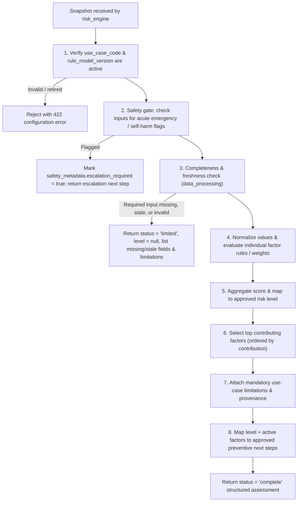

# Albo risk scoring

**Status:** Approved  
**Owner:** Artificial intelligence and clinical/domain governance (shared / collaborator-led)  
**Related:** [AI architecture](AI_ARCHITECTURE.md), [Model documentation](MODEL_DOCUMENTATION.md), [AI safety](AI_SAFETY.md), [Requirements](../01-project-foundation/REQUIREMENTS.md), [Project scope](../01-project-foundation/PROJECT_SCOPE.md), [Database schema](../02-architecture-and-engineering/DATABASE_SCHEMA.md), [API documentation](../02-architecture-and-engineering/API_DOCUMENTATION.md), [UI/UX](../02-architecture-and-engineering/UI_UX.md), [Threat model](../03-security-and-privacy/THREAT_MODEL.md)

## 1. Purpose and scope

This document defines how Albo specifies, calculates, explains, versions, and validates **preventive risk indicators** in `ai-services/risk_engine/`.

The project proposal describes analyzing environmental, behavioral, clinical, and lifestyle information to provide early preventive risk awareness for conditions such as malaria, cholera, respiratory illnesses, mental-wellness concerns, and non-communicable diseases (NCDs), starting with **rule-based and weighted scoring systems** before any machine-learning models are considered.

This contract establishes:

- The strict boundary between a **preventive risk indicator** and a medical diagnosis
- The standardized structure of a rule-based or weighted risk specification
- Candidate risk levels and presentation rules
- Handling of missing, stale, out-of-range, or unverified data
- Provenance, immutable input snapshots, and 100% deterministic reproducibility
- Factor explanation, mandatory limitations, and preventive next-step mapping
- Clinical review, synthetic verification, and lifecycle governance for rule versions

> [!IMPORTANT]
> No scoring formula or threshold in this document is clinically approved yet. Any numbers or factor weights shown below are structural templates only. Before a risk use case is enabled in code, its exact inputs, thresholds, weights, limitations, and next steps must be reviewed by an appropriate health stakeholder and recorded in [MODEL_DOCUMENTATION.md](MODEL_DOCUMENTATION.md) and [DECISIONS.md](../06-technical-decisions/DECISIONS.md).

## 2. Core risk-scoring principles

1. **Preventive indicator, never a diagnosis.** A risk output indicates whether selected self-reported or environmental factors associated with a health concern are present. It never confirms or rules out a disease (FR-013, AI-004, AGENTS.md Rule 10).
2. **Rules and explicit weights first.** Every first-release indicator uses a documented, deterministic rule set or weighted linear rubric whose logic can be inspected line by line by a clinical reviewer (FR-016, PROJECT_SCOPE §3.2).
3. **Never infer "low risk" from missing data.** If required inputs are missing, older than the allowed freshness window, invalid, or from an unavailable source, the calculation must return `status: "limited"` with `level: null`—never a reassuring low-risk level (FR-018, NFR-005, UI_UX §6, T-037).
4. **Deterministic reproducibility.** Executing the same `rule_model_version` against the same `input_snapshot` must produce the exact same status, level, contributing factors, limitations, and next steps every time (FR-019).
5. **Every output explains itself.** An indicator cannot be returned without its contributing factors, source-data references, calculation timestamp, rule version, explicit limitations, and approved preventive next step (FR-012, FR-017, AI-003).
6. **External data requires explicit validation.** Environmental or public-health observations (weather, air quality, rainfall) are used in a calculation only when the data source, geographic mapping, freshness window, and fallback behavior are approved for that use case (ROADMAP §5 Rule 4, DATABASE_SCHEMA §7.2).
7. **Severe or emergency signals bypass normal scoring.** If a user input or check-in indicates an acute emergency, severe symptom, or self-harm risk, the system triggers the reviewed escalation workflow rather than treating it as an ordinary lifestyle risk score (FR-024).

## 3. Candidate use-case domains and release gating

The proposal names five candidate domains. In accordance with PROJECT_SCOPE §3.2 and REQUIREMENTS §9, the first release implements only a **small, explicitly approved subset** (starting with a single use case for the first vertical slice):

| Candidate domain (from proposal) | Example input categories | First-release position | Prerequisites before implementation |
|---|---|---|---|
| **Vector-borne / climate-sensitive exposure** (e.g., malaria preventive exposure indicator) | Regional rainfall/temperature observation, self-reported bed-net or stagnant-water exposure, preventive habit inputs | Candidate for early release (`To validate`) | Approved environmental data source in Rwanda, area-level geographic mapping, clinical review of exposure rubric |
| **Water / hygiene-related exposure** (e.g., cholera / waterborne preventive indicator) | Regional rainfall/flooding context, self-reported water-safety and hygiene practices | Candidate (`To validate`) | Approved public-health/environmental source, reviewed non-diagnostic guidance |
| **Respiratory / air-quality exposure** | Regional air-quality index / PM2.5 observation, self-reported outdoor exposure, smoking/indoor smoke habits | Candidate (`To validate`) | Approved air-quality data source and freshness window, reviewed thresholds |
| **Lifestyle & NCD preventive awareness** (e.g., cardiovascular / metabolic lifestyle indicator) | Physical activity frequency, dietary habits, tobacco/alcohol use, sleep/stress check-ins, approved history fields | Strong candidate for **first vertical slice** (self-contained, does not depend on live third-party weather APIs) | Approved field allowlist, published public-health guideline alignment (e.g., WHO/RBC preventive lifestyle guidelines), clinical reviewer sign-off |
| **Wellbeing & stress pattern indicator** | Structured wellbeing check-in responses (`questionnaire_version`) | Gated by safety and escalation review | Approved questionnaire, reviewed self-harm/crisis escalation flow (FR-024, FR-025) |

## 4. Risk-assessment pipeline

## 5. Standard structure of a rule-set specification

Every rule version in `ai-services/risk_engine/` must be defined as a declarative, version-controlled specification (backed by pure Python evaluation functions) containing the following sections:

### 5.1 Metadata header

- `use_case_code`: Stable identifier matching `risk_use_case.code` (e.g., `lifestyle_ncd_preventive_v1`)
- `rule_model_version`: Semantic version matching `rule_model_version.version` (e.g., `rules-v1.0.0`)
- `implementation_type`: `rule` or `weighted_score`
- `clinical_review_status`: `draft`, `under_review`, `approved`, or `retired`
- `guideline_references`: Published public-health or clinical guidelines informing the rules (for example, WHO or Rwanda Biomedical Centre preventive guidance)
- `intended_use` and `excluded_use`

### 5.2 Required and optional inputs

Each input field in the specification declares:

| Property | Description |
|---|---|
| `field_code` | Must belong to the approved health-input allowlist, check-in schema, or environmental observation type |
| `required` | `true` if the calculation cannot complete without this field; `false` if optional |
| `allowed_sources` | e.g., `["self_reported"]` or `["verified_environmental_adapter"]` |
| `valid_range` / `enum_values` | Strict numeric bounds or allowed categorical values |
| `max_age_hours` (freshness) | Maximum age of `observed_at` relative to `calculated_for_timestamp` before the input is treated as stale |

### 5.3 Factor evaluation rules and weights

To guarantee explainability, complex black-box transformations are prohibited in Phase 1. Allowed rule primitives are:

1. **Threshold / categorical rules:** Map an input value or combination of values to a discrete factor contribution and an `explanation_key`.
2. **Bounded weighted points:** Assign an integer or fixed-decimal weight $w_i \ge 0$ to each evaluated factor $f_i \in [0, 1]$, producing a transparent total:
   $$S = \sum_{i=1}^{n} w_i \cdot f_i$$
3. **Mandatory floor rules (guardrails):** A specific high-priority factor (for example, multiple high-exposure indicators present simultaneously) can set a minimum risk level (such as at least `moderate` or `high`) regardless of the sum of other lifestyle factors.

### 5.4 Risk-level vocabulary (Proposed)

UI_UX §6 and DATABASE_SCHEMA §18 note that the final risk-level vocabulary requires team approval. The proposed standardized vocabulary across all first-release use cases is:

| `status` | `level` | Meaning | UI presentation rule (UI_UX §6) |
|---|---|---|---|
| `complete` | `low` | Evaluated inputs show low presence of the tracked risk factors within the scope of this indicator | Calm presentation; still shows limitations ("Does not mean zero risk") and routine preventive maintenance tips |
| `complete` | `moderate` | One or more modifiable or environmental risk factors are elevated | Highlights contributing factors and practical preventive adjustments |
| `complete` | `high` | Multiple or significant tracked risk factors are elevated | Recommends timely preventive action and surfaces nearby relevant healthcare facilities or approved consultation options (FR-026) |
| `limited` | `null` | Required inputs are missing, stale, or unavailable | Neutral styling ("No current indicator available for this use case"); explains what information is missing or stale |
| `failed` | `null` | Technical failure prevented calculation | Safe unavailable message; prompts retry later |

> [!WARNING]
> Do not use clinical staging terms (`mild`, `severe`, `critical`, `positive`, `negative`, `diagnosed`) as risk levels. If an input indicates an emergency or crisis, use `safety_metadata.escalation_required = true` to trigger emergency guidance rather than inventing a "critical disease score."

## 6. Contributing factors, limitations, and recommendations

### 6.1 Contributing factors

Every `complete` assessment returns the factors that contributed to the result, ordered from highest to lowest contribution:

- `factor_code`: Machine-readable identifier (e.g., `physical_activity_below_guideline`)
- `source_field`: Input `field_code` or `observation_type` that triggered the factor
- `observed_at` and `source_type`: Provenance of that input (`self_reported`, `imported`, etc.)
- `direction`: `"increases_risk"` or `"protective"`
- `explanation_key`: Key mapped to reviewed, plain-language text explaining why this factor matters

### 6.2 Mandatory limitation statements

Every risk assessment response includes at least:

1. **Base non-diagnostic limitation (always present):** Plain-language statement that the output is a preventive risk indicator, not a medical diagnosis or clinical judgment (FR-012, FR-013).
2. **Source provenance limitation:** Notes whether inputs were self-reported or derived from regional (non-individual) environmental observations.
3. **Optional-input limitation (conditional):** If optional inputs were omitted or stale, states which additional factors were not evaluated.

### 6.3 Preventive next steps and facility triggers

Recommendations are selected strictly from an approved catalog of preventive actions tied to the use case, level, and active factors (FR-014):

- **Never prescribe medication, dosages, or clinical procedures.**
- When `level` is `high` (or when a specific factor rule requires professional review), the response includes an action code such as `consider_facility_or_provider_visit` with relevant `facility_service_tags` so the core API can suggest appropriate nearby facilities (FR-026).

## 7. Data quality, freshness, and safe degradation

| Data condition | Engine decision | Reason code in `safety_metadata` |
|---|---|---|
| Required health input never submitted | `status: "limited"`, `level: null` | `MISSING_REQUIRED_INPUT` |
| Required input older than `max_age_hours` | `status: "limited"`, `level: null` | `STALE_REQUIRED_INPUT` |
| Environmental observation missing or marked `failed`/`unverified` for a use case that requires it | `status: "limited"`, `level: null` | `ENVIRONMENTAL_SOURCE_UNAVAILABLE` |
| Optional input missing or stale | Proceed with calculation; append conditional limitation statement | `OPTIONAL_INPUT_OMITTED` |
| Input value outside physiological/schema bounds | Reject request (`422`) or mark `limited` | `INVALID_INPUT_RANGE` |

## 8. Reproducibility and auditability

To satisfy FR-017, FR-019, and DATABASE_SCHEMA §8.3:

1. **No hidden state or wall-clock drift:** The scoring engine uses the `calculated_for_timestamp` and exact values inside the `input_snapshot` payload. It never queries live external APIs or reads `datetime.now()` to make threshold decisions.
2. **No unseeded randomness:** Phase 1 rules are 100% deterministic. Any future Phase 3 statistical model must be deterministic at inference time.
3. **Immutable rule versions:** Once a `rule_model_version` has produced assessments in an environment, its thresholds, weights, and factor mappings are never mutated in place. Any adjustment increments the version.

## 9. Validation, testing, and clinical review workflow

Before a rule set or version is marked `approved` for use:

1. **Specification authoring:** Document the use case, inputs, freshness windows, weights/thresholds, limitations, and next steps in [MODEL_DOCUMENTATION.md](MODEL_DOCUMENTATION.md).
2. **Clinical / health-domain review:** A qualified reviewer verifies that the factors, thresholds, wording, and escalation boundaries align with accepted preventive-health guidance and cannot mislead users into delaying care.
3. **Synthetic test matrix (`Pytest`):**
   - Boundary value tests at every threshold transition (`low` ↔ `moderate` ↔ `high`)
   - Missing and stale input tests proving `status: "limited"` and `level: null`
   - Determinism test running the same snapshot 100 times
   - Safety test verifying emergency/self-harm flags trigger escalation
   - Prohibited-wording test verifying no output string claims a diagnosis or prescription
4. **Approval record:** Record the approved version and reviewer sign-off in [DECISIONS.md](../06-technical-decisions/DECISIONS.md).

## 10. Future transition to machine-learning models (`Later`)

In alignment with FR-020, AI-006, and ROADMAP Phase 7:

- A machine-learning model (e.g., calibrated logistic regression, random forest, or XGBoost) may be evaluated only after structured data quality, clinical labeling governance, and privacy consent for model development are established.
- **Shadow / benchmark requirement:** Any candidate ML model must be benchmarked against the existing deterministic rule version on representative evaluation sets, including calibration across age, sex, and geographic subgroups.
- **Explainability preservation:** An ML model must still output structured contributing factors, limitations, and provenance compatible with the API contract, and must keep the deterministic rule set available as an immediate rollback fallback.

## 11. First-release risk-scoring scope

Aligned with the first vertical slice in [PROJECT_STATUS.md](../PROJECT_STATUS.md) and SYSTEM_DESIGN §20:

- One approved first-release preventive risk use case (recommended: a self-contained lifestyle/preventive indicator using one or a small set of approved synthetic health/lifestyle inputs so the slice does not block on external weather providers)
- One versioned deterministic rule specification (`rules-v1.0.0`)
- Full completeness, range, and freshness validation returning `complete` or `limited`
- Structured output with risk level, contributing factors, non-diagnostic limitations, and next step
- Automated Pytest suite verifying every branch of the rule set on synthetic profiles

## 12. Acceptance criteria

The risk-scoring design is ready for first-release implementation when:

- The risk-level vocabulary (`low`, `moderate`, `high`, plus `limited`/`failed` statuses) is approved.
- The first vertical-slice risk use case, its exact input fields, and its freshness rules are selected.
- A qualified reviewer approves the first rule version's logic, limitations, and next-step wording.
- The rule version is cataloged in [MODEL_DOCUMENTATION.md](MODEL_DOCUMENTATION.md).
- Decisions are recorded in [DECISIONS.md](../06-technical-decisions/DECISIONS.md).

## 13. Open risk-scoring decisions

- Exact risk use case(s) for the first vertical slice and first release
- Named clinical/public-health reviewer(s) for rule sign-off
- Final risk-level vocabulary (`low` / `moderate` / `high` vs. alternative labels)
- Freshness windows (`max_age_hours`) for self-reported lifestyle inputs versus environmental observations
- Whether numerical score values are ever shown to citizens, or only the discrete level (`low`/`moderate`/`high`) and contributing factors (recommended: show discrete level and factors only, to avoid false precision)
- How concurrent risk assessments across multiple use cases are ordered on the citizen dashboard
