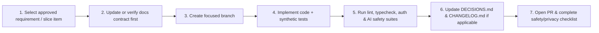

# Contributing to Albo

**Status:** Approved — workflow guide for team members, collaborators, and AI coding agents  
**Owner:** Shared engineering team (Apex Phantoms / Albo contributors)  
**Related:** [AGENTS.md](../../AGENTS.md), [Documentation map](../README.md), [Project status](../PROJECT_STATUS.md), [Coding standards](CODING_STANDARDS.md), [Testing strategy](TESTING_STRATEGY.md), [Deployment](DEPLOYMENT.md), [Decisions](../06-technical-decisions/DECISIONS.md), [Changelog](../06-technical-decisions/CHANGELOG.md)

## 1. Purpose

Albo is a preventive digital-health platform handling sensitive health, wellbeing, location, and provider information. Every contribution—whether a documentation refinement, a database migration, a backend API route, an AI risk rule, or a UI component—must preserve user safety, data privacy, explainability, and architectural clarity.

This guide defines how human collaborators and AI coding agents propose, implement, verify, and merge changes.

## 2. Before you write code

1. **Read the required context first ([AGENTS.md](../../AGENTS.md)):**
   - [PROJECT_OVERVIEW.md](../01-project-foundation/PROJECT_OVERVIEW.md), [PROJECT_SCOPE.md](../01-project-foundation/PROJECT_SCOPE.md), and [REQUIREMENTS.md](../01-project-foundation/REQUIREMENTS.md)
   - [ARCHITECTURE.md](../02-architecture-and-engineering/ARCHITECTURE.md), [SYSTEM_DESIGN.md](../02-architecture-and-engineering/SYSTEM_DESIGN.md), [DATABASE_SCHEMA.md](../02-architecture-and-engineering/DATABASE_SCHEMA.md), and [API_DOCUMENTATION.md](../02-architecture-and-engineering/API_DOCUMENTATION.md)
   - [ACCESS_CONTROL.md](../03-security-and-privacy/ACCESS_CONTROL.md), [SECURITY.md](../03-security-and-privacy/SECURITY.md), and [DATA_PRIVACY.md](../03-security-and-privacy/DATA_PRIVACY.md)
   - [AI_SAFETY.md](../04-artificial-intelligence/AI_SAFETY.md) and [RISK_SCORING.md](../04-artificial-intelligence/RISK_SCORING.md)
2. **Confirm the work is in current scope:**
   - Check [PROJECT_SCOPE.md](../01-project-foundation/PROJECT_SCOPE.md) and [ROADMAP.md](../01-project-foundation/ROADMAP.md).
   - Features marked `Later` (such as live video consultations, wearable device sync, full EHR exchange, or predictive ML models replacing deterministic rules) must not be added informally.
3. **Check open decisions:**
   - If a task depends on an open decision (`Proposed` or `To validate`), resolve and record that decision in [DECISIONS.md](../06-technical-decisions/DECISIONS.md) rather than silently hardcoding an unapproved contract.

## 3. Contribution workflow



### 3.1 Branching and commit conventions

- Keep branches small and focused on one vertical slice step, module, or documentation area:
  - `docs/<topic>` — documentation contracts and decision records
  - `feat/<module>-<short-description>` — new approved capability (e.g., `feat/consent-grant-withdraw`)
  - `fix/<module>-<short-description>` — bug or safety fix
  - `test/<module>-<short-description>` — test coverage additions
  - `chore/<topic>` — tooling, CI, or dependency maintenance
- Write clear, imperative commit messages summarizing **what** changed and **why**.
- Never include real personal names, health data, or credentials in branch names, commit messages, or pull-request descriptions.

### 3.2 Keeping documentation and code synchronized (AGENTS.md Rule 4)

A pull request that changes any of the following **must** update the corresponding markdown file in the same pull request:

| If your change affects... | You must update... |
|---|---|
| Public API routes, payloads, status codes, or internal AI endpoints | [API_DOCUMENTATION.md](../02-architecture-and-engineering/API_DOCUMENTATION.md) and/or [AI_ARCHITECTURE.md](../04-artificial-intelligence/AI_ARCHITECTURE.md) |
| Database tables, columns, constraints, indexes, or retention rules | [DATABASE_SCHEMA.md](../02-architecture-and-engineering/DATABASE_SCHEMA.md) |
| Roles, permissions, assignment scoping, or consent checks | [ACCESS_CONTROL.md](../03-security-and-privacy/ACCESS_CONTROL.md) |
| Risk scoring rules, weights, thresholds, freshness windows, or assistant behavior | [RISK_SCORING.md](../04-artificial-intelligence/RISK_SCORING.md), [AI_ASSISTANT.md](../04-artificial-intelligence/AI_ASSISTANT.md), and [MODEL_DOCUMENTATION.md](../04-artificial-intelligence/MODEL_DOCUMENTATION.md) |
| External provider adapters, timeouts, or fallbacks | [INTEGRATIONS.md](../02-architecture-and-engineering/INTEGRATIONS.md) |
| New threat vector or mitigation | [THREAT_MODEL.md](../03-security-and-privacy/THREAT_MODEL.md) |
| Significant architectural, product, privacy, or clinical decision | [DECISIONS.md](../06-technical-decisions/DECISIONS.md) and [CHANGELOG.md](../06-technical-decisions/CHANGELOG.md) |

## 4. Non-negotiable safety and privacy rules for contributors

Every contributor must uphold the 12 rules in [AGENTS.md](../../AGENTS.md):

1. **Never commit secrets.** If a secret or API key is ever accidentally committed, treat it as compromised immediately, rotate it, and notify the security owner ([SECURITY.md](../03-security-and-privacy/SECURITY.md) §7).
2. **Never use real patient or citizen data.** All local databases, seed scripts, unit tests, AI evaluation prompts, and UI screenshots must use 100% synthetic data ([TESTING_STRATEGY.md](TESTING_STRATEGY.md) §5).
3. **Never present AI output as a medical diagnosis or prescription.** Always include provenance, contributing factors, mandatory limitation text, and approved preventive next steps ([AI_SAFETY.md](../04-artificial-intelligence/AI_SAFETY.md) §2).
4. **Never default missing or stale data to "low risk."** Always return `status: "limited"` (`level: null`) when required inputs are incomplete, stale, or unavailable ([RISK_SCORING.md](../04-artificial-intelligence/RISK_SCORING.md) §2, §7).
5. **Never log sensitive payloads.** Keep raw health inputs, wellbeing check-in answers, precise coordinates, tokens, and AI prompts out of application logs and error responses ([CODING_STANDARDS.md](CODING_STANDARDS.md) §8.2).

## 5. Review and approval requirements

| Change category | Required reviewers |
|---|---|
| Standard UI, refactoring, or non-sensitive tooling | 1 engineering peer review |
| Authentication, authorization, consent, database migrations, external integrations, or logging/redaction ([SECURITY.md](../03-security-and-privacy/SECURITY.md) §13) | 2 reviewers (including security/architecture owner) |
| Risk scoring formulas/thresholds, check-in questionnaires, assistant prompts/filters, or emergency escalation logic ([AI_SAFETY.md](../04-artificial-intelligence/AI_SAFETY.md)) | Technical owner **plus** designated clinical/health-domain reviewer sign-off |

## 6. Pull-request template checklist

Copy and verify this checklist when submitting a pull request:

```markdown
### Summary
- Requirement / threat ID(s): e.g., `FR-003`, `DP-002`, `T-003`
- Related docs updated: e.g., `API_DOCUMENTATION.md`, `DECISIONS.md`

### Verification checklist
- [ ] Follows component boundaries (`frontend/` vs. `backend/` vs. `ai-services/`)
- [ ] Derives caller identity from validated token; enforces role, ownership/assignment, and active consent
- [ ] Preserves non-diagnostic framing, limitations, provenance, and `limited` status on missing/stale inputs
- [ ] Contains zero hardcoded secrets and uses 100% synthetic data in fixtures/tests/screenshots
- [ ] Logs, audit events, and error responses are free of sensitive health, identity, location, or prompt payloads
- [ ] Automated unit, integration, authorization, and AI safety tests added and passing
```

## 7. Working with AI coding agents

When using an AI coding agent on this repository:

- Point the agent to [AGENTS.md](../../AGENTS.md) and the specific contract files in `docs/` for the slice being built.
- Do not ask the agent to scaffold the entire platform at once; implement and verify one vertical slice or module boundary at a time (starting with the first vertical slice in [SYSTEM_DESIGN.md](../02-architecture-and-engineering/SYSTEM_DESIGN.md) §20).
- Verify that any code generated by an agent passes the authorization test matrix ([TESTING_STRATEGY.md](TESTING_STRATEGY.md) §4.1) and AI safety suites ([AI_SAFETY.md](../04-artificial-intelligence/AI_SAFETY.md) §5) before merging.
