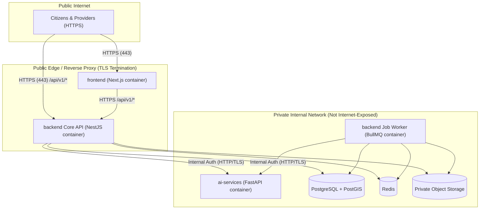
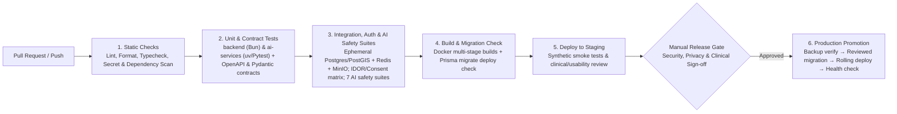

# Albo deployment and operations

**Status:** Approved — defines local, CI/CD, staging, and production deployment standards  
**Owner:** Shared engineering and operations team  
**Related:** [Coding standards](CODING_STANDARDS.md), [Testing strategy](TESTING_STRATEGY.md), [Contributing](CONTRIBUTING.md), [Architecture](../02-architecture-and-engineering/ARCHITECTURE.md), [System design](../02-architecture-and-engineering/SYSTEM_DESIGN.md), [Tech stack](../02-architecture-and-engineering/TECH_STACK.md), [Security](../03-security-and-privacy/SECURITY.md), [Data privacy](../03-security-and-privacy/DATA_PRIVACY.md), [AI safety](../04-artificial-intelligence/AI_SAFETY.md)

## 1. Purpose and scope

This document defines how Albo is packaged, configured, deployed, monitored, backed up, and rolled back across local development, automated CI, staging, and production environments.

In accordance with ARCHITECTURE §12 and TECH_STACK §11:

- **Docker** is the standard packaging baseline for all services.
- **Simplicity first:** The initial deployment runs as a small set of independently deployable containers (`frontend`, `backend` core API, `backend` job worker, `ai-services`, plus managed or containerized PostgreSQL/PostGIS, Redis, and private S3-compatible object storage).
- **Kubernetes is not an initial requirement** (ARCHITECTURE §12, TECH_STACK §11) and must not be introduced until operational scale or team structure justifies it.
- **Strict environment isolation and Rwanda data-residency compliance** govern where real personal health data may be hosted ([DATA_PRIVACY.md](../03-security-and-privacy/DATA_PRIVACY.md) §3.1, §12).

## 2. Deployment topology and network boundaries

### 2.1 Container and service inventory

> **Onboarding topology note ([ADR-016](../06-technical-decisions/DECISIONS.md)):** Initial engineering onboarding packages and runs the backend and AI container topology (`core-api`, `job-worker`, `ai-services`, `postgres` via `postgis/postgis:16-3.4`, `redis` via `redis:7-alpine`, `object-storage` via `minio/minio`, plus a one-shot `migrate` container). The `frontend` container is deferred to the separate frontend onboarding track.

| Deployable unit | Source directory | Network exposure | Statefulness | Scaling rule |
|---|---|---|---|---|
| `frontend` *(deferred per `ADR-016`)* | `frontend/` | Public via HTTPS reverse proxy | Stateless | Horizontal replicas |
| `core-api` | `backend/` | Public `/api/v1/*` via HTTPS reverse proxy (`127.0.0.1:4000` locally) | Stateless | Horizontal replicas |
| `job-worker` | `backend/` (worker entrypoint) | **Private only** (no inbound public ports) | Stateless worker (state in Redis/PostgreSQL) | Horizontal replicas by queue depth |
| `ai-services` | `ai-services/` | **Private only** (callable only by `core-api` and `job-worker`) | Stateless (loads versioned rule/model code) | Horizontal replicas by CPU/latency |
| `postgres` | Managed PostgreSQL/PostGIS (`postgis/postgis:16-3.4` in local/CI) | **Private only** | Durable primary data store | Vertical + read replicas when needed; encrypted backups |
| `redis` | Managed Redis (`redis:7-alpine` in local/CI) | **Private only** | Ephemeral cache, rate limits, job queue | Authenticated, private |
| `object-storage` | S3-compatible private bucket (`minio/minio` in local/CI) | **Private buckets only** (access via short-lived presigned URLs) | Durable report files | Managed storage |

## 3. Environment matrix and isolation rules

Following SYSTEM_DESIGN §19 and [SECURITY.md](../03-security-and-privacy/SECURITY.md) §11:

| Environment | Purpose | Allowed data | External integrations | Secret scope |
|---|---|---|---|---|
| **Local (`development`)** | Developer & AI-agent workstation (`docker compose`) | 100% synthetic seeds & fixtures | Local mocks or sandbox keys only | Local `.env` (uncommitted) with local dummy secrets |
| **CI (`test`)** | Automated pull-request verification (GitHub Actions) | 100% synthetic test fixtures in ephemeral containers | Deterministic mocks / recorded contracts | Ephemeral CI test secrets only |
| **Staging (`staging`)** | Pre-release integration, usability, accessibility, and safety review | **100% synthetic data only** (no real patient/citizen records) | Vendor sandboxes or rate-limited staging accounts | Dedicated staging secret store |
| **Production (`production`)** | Live preventive-health platform | Consented real user data (only after legal, privacy, NCSA, and clinical safety gates pass) | Approved production providers under DPAs | Production secret manager; restricted operator access |

> [!CAUTION]
> **Hard isolation rule:** Production database dumps, backups, object-storage buckets, and secrets must **never** be copied into `staging`, `test`, or `development` (DP-005, SYSTEM_DESIGN §19, T-031).

## 4. Configuration and secrets management

1. **Environment variables and validation at startup:**
   - Every service validates its required environment variables against a strict schema on boot (e.g., NestJS `ConfigModule` validation schema and FastAPI `pydantic-settings`).
   - If a required variable (such as token issuer URL, internal service auth secret, or database URL) is missing or invalid, the container fails fast at startup rather than running in an insecure fallback state.
2. **Secret storage:**
   - In `staging` and `production`, secrets are injected at runtime from an approved secret manager or encrypted platform secret store ([SECURITY.md](../03-security-and-privacy/SECURITY.md) §7, DP-004).
   - `.env.example` files in the repository document variable names and safe dummy defaults only.
3. **Feature flags and AI safety kill switches ([ADR-017](../06-technical-decisions/DECISIONS.md)):**
   - Deployment configuration enforces runtime circuit breakers to disable gated features immediately without code changes ([AI_SAFETY.md](../04-artificial-intelligence/AI_SAFETY.md) §6):
     - `FEATURE_ASSISTANT_ENABLED=false` (default `false` in `production` until `OPEN-006` and `OPEN-011` gates pass)
     - `FEATURE_PROVIDER_PORTAL_ENABLED=false` (default `false` in `production` pending `OPEN-009`)
     - `FEATURE_CHECKINS_ENABLED=false` (default `false` in `production` until `OPEN-006` escalation directory is approved)
     - `APPROVED_RISK_RULE_VERSIONS` allowlist per use case (default `lifestyle_ncd_preventive:rules-v1.0.0`)

## 5. Container build hardening (`Dockerfile` standards)

All Dockerfiles (`backend/Dockerfile`, `ai-services/Dockerfile`, and `frontend/Dockerfile` once onboarded per [ADR-016](../06-technical-decisions/DECISIONS.md)) must follow these rules:

- **Multi-stage builds:** Compile TypeScript or install Python virtual environments in a builder stage; copy only production artifacts and runtime dependencies into a minimal pinned runtime image (`oven/bun` slim/alpine for `backend/`, `python:3.12-slim` for `ai-services/`).
- **Pinned base images and lockfiles:** Enforce deterministic lockfile installs (`bun install --frozen-lockfile` against `bun.lock` for `backend/`, and `uv sync --frozen --no-dev` against `uv.lock` for `ai-services/`).
- **Non-root execution:** Create and run as a dedicated non-root user (`USER albo`).
- **No secrets in build layers:** Never pass runtime secrets via `ARG` or `ENV` inside a `Dockerfile` or bake `.env` files into images (enforce via `.dockerignore`).
- **Healthcheck declaration:** Expose `/health/live` & `/health/ready` (`backend/`) and `/internal/v1/health` (`ai-services/`) for orchestrator readiness and liveness probes.

## 6. CI/CD pipeline and promotion gates

Aligning with TECH_STACK §11 and [ADR-016](../06-technical-decisions/DECISIONS.md) (GitHub Actions CI):

### 6.1 Required CI checks on every pull request

1. Secret scan (`gitleaks` / `trufflehog`) and dependency vulnerability scan (`bun audit`, `uv run pip-audit`)
2. Linting, formatting, and strict type checking across `backend/` (`bun`) and `ai-services/` (`uv` + `ruff` + `mypy`) *(plus `frontend/` once onboarded per `ADR-016`)*
3. Unit tests and OpenAPI / internal AI contract verification
4. Database migration check (`prisma migrate deploy`) against an ephemeral `postgis/postgis:16-3.4` service container
5. Backend integration test suite (including the mandatory authorization, IDOR, consent-withdrawal, supersession, and audit-redaction matrix from [TESTING_STRATEGY.md](TESTING_STRATEGY.md) §4.1–4.2)
6. AI service evaluation suite (`ai-services/evaluation/` reproducibility, `limited`-status degradation, non-diagnostic wording, crisis escalation recall, and log redaction)
7. Docker image build verification *(plus Playwright E2E once `frontend/` is onboarded per `ADR-016`)*

## 7. Database migration deployment rules

Following DATABASE_SCHEMA §16 and [ADR-012](../06-technical-decisions/DECISIONS.md):

1. **Backward-compatible (expand-and-contract) migrations:**
   - Schema migrations run via `prisma migrate deploy` as a dedicated, gated step before new application containers receive traffic.
   - Destructive column/table drops must be staged across two releases so an immediate application container rollback remains compatible with the database schema.
2. **Pre-migration backup:** In production, an automated database snapshot/backup must succeed immediately before applying any pending migration.
3. **Least-privilege DB roles:** The runtime `core-api` and `job-worker` database user has `SELECT, INSERT, UPDATE, DELETE` permissions only (and append-only on `audit_event` where configured); `DDL` (`ALTER`, `DROP`, `CREATE`) is restricted to the migration runner credentials ([SECURITY.md](../03-security-and-privacy/SECURITY.md) §11).

## 8. Health checks, observability, and alerting

Following ARCHITECTURE §14 and SYSTEM_DESIGN §18:

- **Health endpoints:**
  - `core-api`: liveness (`/health/live`) and readiness (`/health/ready` verifying PostgreSQL, Redis, and `ai-services` reachability)
  - `ai-services`: `/internal/v1/health` returning loaded `rule_model_version` identifiers
- **Redacted structured logs and OpenTelemetry traces:**
  - Correlate requests across `core-api` → `job-worker` → `ai-services` (and `frontend` when onboarded) using `X-Request-Id` and W3C trace context.
  - Enforce the log redaction allowlist in [CODING_STANDARDS.md](CODING_STANDARDS.md) §8.2.
- **Operational alerts:**
  - Elevated `5xx` error rates or health-check failures
  - Spikes in `401`/`403` authentication/authorization failures (T-001, T-002, T-034)
  - BullMQ dead-letter queue growth or stuck jobs
  - AI safety-filter block triggers or spikes in `failed` risk assessments
  - External provider timeout/circuit-breaker trips

## 9. Backup, disaster recovery, and rollback

### 9.1 Backups and restoration (NFR-006)

- Automated daily encrypted backups (plus point-in-time recovery where supported by the hosting provider) for PostgreSQL and private object storage.
- Backups are stored in a separate fault domain within the approved data-residency boundary ([DATA_PRIVACY.md](../03-security-and-privacy/DATA_PRIVACY.md) §12).
- **Mandatory restore drill:** A full backup restoration into an isolated recovery environment must be tested and documented before production health data is accepted (ARCHITECTURE §13).
- When restoring a backup after a disaster, any account deletions executed after the backup timestamp must be re-applied from the deletion log before reopening traffic ([DATA_PRIVACY.md](../03-security-and-privacy/DATA_PRIVACY.md) §8.1).

### 9.2 Rollback procedures

1. **Application container rollback:** Redeploy the previous immutable image tag (pinned by Git commit SHA) and verify health checks.
2. **Rule or model version rollback:** Update the active `APPROVED_RISK_RULE_VERSIONS` configuration in the core API to the prior approved version, or toggle the use-case kill switch to return `status: "limited"` immediately ([AI_SAFETY.md](../04-artificial-intelligence/AI_SAFETY.md) §6).

## 10. Pre-production readiness checklist

Before switching the production environment to accept real citizen data:

- [ ] Hosting provider and region approved for Rwanda Law N° 058/2021 data-residency compliance (or NCSA cross-border authorization obtained) and NCSA controller registration completed ([DATA_PRIVACY.md](../03-security-and-privacy/DATA_PRIVACY.md) §3.1, §12).
- [ ] TLS, HSTS, CSP, CORS, and private internal networking verified ([SECURITY.md](../03-security-and-privacy/SECURITY.md) §6.2, §8.3, §11).
- [ ] Secret manager configured and verified; zero default/development credentials present.
- [ ] Encrypted backup and full restore drill completed and timed against recovery targets.
- [ ] First-release risk rules and crisis escalation contacts clinically reviewed and recorded in [MODEL_DOCUMENTATION.md](../04-artificial-intelligence/MODEL_DOCUMENTATION.md) and [DECISIONS.md](../06-technical-decisions/DECISIONS.md).
- [ ] Incident-response owner and 48-hour breach notification procedure active ([SECURITY.md](../03-security-and-privacy/SECURITY.md) §15, [DATA_PRIVACY.md](../03-security-and-privacy/DATA_PRIVACY.md) §15).

## 11. Open and resolved deployment decisions

### Resolved for local/CI onboarding
- **CI platform and local container stack:** **Resolved in [ADR-016](../06-technical-decisions/DECISIONS.md)** — GitHub Actions (`.github/workflows/ci.yml`), Bun (`bun install --frozen-lockfile`), Python 3.12 + `uv` (`uv sync --frozen`), and Docker Compose (`postgis/postgis:16-3.4`, `redis:7-alpine`, `minio/minio`), without initial Kubernetes (`ADR-008`).

### Remaining staging & production decisions (`OPEN-007`, `OPEN-012`)
- Hosting provider and region satisfying Rwanda data residency and team budget (`OPEN-007`, `OPEN-012`)
- Production container runtime platform, production S3-compatible object storage vendor, CD promotion target, and secret manager choice (`OPEN-012`)
- Recovery Point Objective (RPO) and Recovery Time Objective (RTO) targets (`OPEN-012`)
- Observability backend (e.g., Grafana stack / OpenTelemetry collector target) and log retention window (`OPEN-008`, `OPEN-012`)
