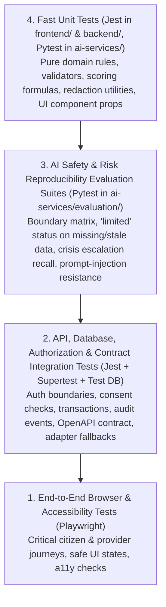

# Albo testing strategy

**Status:** Approved — applies to all phases starting with the first vertical slice  
**Owner:** Shared engineering team  
**Related:** [Coding standards](CODING_STANDARDS.md), [Deployment](DEPLOYMENT.md), [Contributing](CONTRIBUTING.md), [Requirements](../01-project-foundation/REQUIREMENTS.md), [System design](../02-architecture-and-engineering/SYSTEM_DESIGN.md), [API documentation](../02-architecture-and-engineering/API_DOCUMENTATION.md), [Tech stack](../02-architecture-and-engineering/TECH_STACK.md), [Access control](../03-security-and-privacy/ACCESS_CONTROL.md), [Security](../03-security-and-privacy/SECURITY.md), [AI safety](../04-artificial-intelligence/AI_SAFETY.md)

## 1. Purpose and scope

This document defines how Albo verifies correctness, authorization boundaries, privacy redaction, resilience, accessibility, and AI/clinical safety before any code is merged or deployed.

Because Albo processes sensitive preventive-health data and calculates risk indicators, testing is not limited to happy-path feature checks. Every feature must prove that **unauthorized access fails safely**, **missing or stale data never produces a false low-risk conclusion**, **sensitive payloads never leak into logs or error responses**, and **emergency/self-harm signals trigger immediate escalation**.

## 2. Core testing principles

1. **No untested behavior.** Every new requirement, endpoint, risk rule, safety filter, or bug fix ships with automated tests (AGENTS.md Rule 6, NFR-014).
2. **100% synthetic test data.** Real patient records, real user identities, and production credentials are strictly prohibited across all test layers, fixtures, snapshots, and CI environments (AGENTS.md Rules 7–9, DP-005, TECH_STACK §10).
3. **Security and safety are first-class test gates.** Authorization tests (NFR-002), consent-withdrawal tests, log-redaction tests, and AI safety evaluation suites (AI-005) are mandatory release gates in CI.
4. **Deterministic and isolated tests.** Automated tests must not depend on live external third-party APIs (weather, maps, external LLMs, notification gateways) or wall-clock time. External providers are tested via contract mocks and sandboxes (INTEGRATIONS §17).
5. **Traceability to requirements.** Acceptance and integration tests reference the requirement IDs (`FR-*`, `DP-*`, `AI-*`, `NFR-*`) and threat IDs (`T-*`, `HAZ-*`) they verify.

## 3. Testing pyramid and toolchain

Aligning with TECH_STACK §10:

| Test layer | Location | Primary tools | Execution trigger |
|---|---|---|---|
| **Unit tests** | `backend/` (Bun), `ai-services/tests/unit/` (`uv`), *(plus `frontend/` when onboarded per `ADR-016`)* | Jest (via `bun run test`), Pytest (via `uv run pytest`), *(Vitest + RTL when `frontend/` is onboarded)* | Pre-commit / every PR in CI |
| **Database & migration tests** | `backend/test/database/` | Jest + ephemeral `postgis/postgis:16-3.4` container | Every PR in CI |
| **API & authorization integration tests** | `backend/test/integration/` | Jest + Supertest + ephemeral PostgreSQL, Redis, & MinIO | Every PR in CI |
| **OpenAPI & internal AI contract tests** | `backend/test/contracts/`, `ai-services/tests/contracts/` | OpenAPI schema validator, Pydantic v2 contract fixtures | Every PR in CI |
| **AI safety & evaluation suites** | `ai-services/evaluation/` | Pytest + versioned synthetic benchmark datasets | Every PR touching `ai-services/` or rule configs, plus pre-release |
| **End-to-end (E2E) & accessibility tests** | `frontend/tests/e2e/` *(deferred with `frontend/` per [ADR-016](../06-technical-decisions/DECISIONS.md))* | Playwright + `@axe-core/playwright` | Every PR affecting vertical slices once `frontend/` is onboarded |

## 4. Mandatory test suites by domain

### 4.1 Authentication, authorization, and consent boundary tests (NFR-002, API §12)

Every protected endpoint in `backend/` must be tested against the full access matrix defined in [ACCESS_CONTROL.md](../03-security-and-privacy/ACCESS_CONTROL.md) §16:

| Test case | Expected result | Threat / Req covered |
|---|---|---|
| Missing, expired, malformed, wrong-issuer, or wrong-audience bearer token | `401 UNAUTHENTICATED` | NFR-001, T-001 |
| Suspended or deleted `user_account` with a still-unexpired token | `403 FORBIDDEN` | ACCESS_CONTROL §3 |
| **Horizontal IDOR check:** Citizen A requests or mutates Citizen B's profile, health input, check-in, risk assessment, or report by ID | `404 NOT_FOUND` (never leaks existence or data) | DP-002, T-003 |
| **Body/query spoofing check:** Citizen A sends `"user_id": "<Citizen-B-ID>"` in a `POST` or `PATCH` body | Ignored or rejected (`400`/`422`); never writes to Citizen B | API §4.3, T-004 |
| **Pagination & search isolation:** Citizen A lists inputs/assessments when Citizen B's records exist in the database | Only Citizen A's records returned; total/cursor never reflects Citizen B | API §5.4, T-009 |
| **Role isolation:** `platform_admin` attempts to call citizen health-record or provider patient-detail routes | `403 FORBIDDEN` or `404 NOT_FOUND` | FR-035, T-032 |
| **Provider assignment matrix (when provider access is enabled):** Provider with no assignment, expired assignment, wrong organization, or out-of-scope assignment attempts access | `404 NOT_FOUND` | FR-031, T-034 |
| **Consent gate & withdrawal:** Citizen requests risk calculation without required consent, or Provider accesses Citizen after Citizen withdraws sharing consent | Calculation returns `limited`/denied; Provider receives `404 NOT_FOUND`; queued job skips execution | FR-003, FR-018, T-044 |

### 4.2 Database, transaction, and audit tests (NFR-003, NFR-004)

- **Migration up/down verification:** Every migration is applied to a clean PostgreSQL/PostGIS test instance, verified with synthetic seed data, and tested for rollback safety where supported.
- **Referential integrity & controlled deletion:** Verify that deleting or suspending an account does not accidentally cascade-delete required audit records, and that invalid enum values (`status`, `level`) are rejected by database constraints (DATABASE_SCHEMA §13).
- **Transactional atomicity:** Simulate a failure mid-transaction (e.g., audit write fails during consent update) and verify the primary state change rolls back cleanly.
- **Audit event verification & redaction:** Verify that every sensitive access, consent change, risk calculation, provider follow-up, and authorization denial writes an `audit_event` with `actor_id`, `action`, `resource_type`, `resource_id`, `outcome`, and `request_id`—and assert that the stored `metadata` JSON contains **zero** tokens, passwords, health input values, or raw prompts (FR-038, FR-039).

### 4.3 Risk engine and AI safety evaluation tests (FR-016 to FR-019, AI-005)

Located in `ai-services/tests/` and `ai-services/evaluation/`, implementing the 7 suites defined in [AI_SAFETY.md](../04-artificial-intelligence/AI_SAFETY.md) §5:

1. **Threshold & boundary matrix:** Test every rule condition and weighted-score cutoff (`low` ↔ `moderate` ↔ `high`), including floor guardrails and protective vs. risk-increasing factor ordering.
2. **Reproducibility test (FR-019):** Run the same `input_snapshot` and `rule_model_version` repeatedly at different wall-clock times and assert byte-identical calculation results.
3. **Missing, stale, and invalid input degradation (FR-018, HAZ-01):**
   - Omit each required input field one by one → assert `status == "limited"` and `level is None`.
   - Set `observed_at` older than `max_age_hours` → assert `status == "limited"` and `level is None`.
   - Pass an out-of-range physiological value → assert `422` or `limited`.
4. **Non-diagnostic & non-prescriptive output verification (FR-013, FR-014, HAZ-03):** Assert every completed assessment includes mandatory `limitations`, provenance references, and only allowlisted preventive action codes.
5. **Crisis and emergency escalation recall (FR-024, HAZ-02):** Run the synthetic self-harm, suicidal ideation, and severe physical danger-sign benchmark suite against the check-in and assistant safety screener; require **100% recall** and verify `safety_metadata.escalation_required == True`.
6. **Adversarial prompt-injection and hallucination suite (HAZ-04, HAZ-06):** Test assistant endpoints with synthetic jailbreak prompts and verify zero diagnostic/prescription outputs, zero cross-user leakage, and zero hallucinated facility details.

### 4.4 External integration and degraded-mode tests (NFR-005, INTEGRATIONS §17)

Every adapter in `backend/src/integrations/` must have automated tests using recorded contract fixtures or local mock servers covering:

- Valid response parsing, unit normalization, and provenance timestamp capture
- HTTP `429` rate limit, `500`/`503` server error, and network timeout handling
- Malformed or stale upstream payload rejection
- **Safe user-facing fallback:** Verify that when the weather adapter or AI service is unreachable, the core API returns an explicit `unavailable` or `limited` state and never fabricates data or defaults to low risk (SYSTEM_DESIGN §16).

### 4.5 Frontend component, journey, and accessibility tests (NFR-010 to NFR-012)

- **Component safety tests:** Verify `RiskIndicatorCard` renders the risk level label, contributing factors, timestamp, rule version, non-diagnostic limitation banner, and next step—and renders a neutral (non-green) card when `status === "limited"`.
- **Accessibility checks:** Run `@axe-core/playwright` on every first-release screen (landing, onboarding/consent, dashboard, risk detail, facilities, reports) verifying WCAG contrast, keyboard navigation, form labels, and non-color-only risk indicators (UI_UX §12).
- **Privacy in browser state:** Assert during E2E runs that browser URLs, `localStorage` (where prohibited), and console logs contain no health input payloads.

## 5. Synthetic test data and fixture governance

To comply with AGENTS.md Rules 8–9 and DP-005:

- Store shared synthetic personas and fixtures in version-controlled directories (`backend/test/fixtures/synthetic/` and `ai-services/evaluation/datasets/synthetic/`).
- Every fixture file must begin with a header comment or metadata block: `"synthetic": true, "source": "synthetic_test_fixture"`.
- Use obviously synthetic identifiers (e.g., `.example.invalid` email domains, reserved documentation phone ranges, synthetic UUID seeds).
- Never copy-paste anonymized rows from any real clinic, hospital, or user database into test files.

## 6. First vertical-slice acceptance test plan

Before the first vertical slice ([PROJECT_STATUS.md](../PROJECT_STATUS.md) §10, SYSTEM_DESIGN §20) is marked complete, the following automated integration and end-to-end scenario must pass in CI:

1. **Auth & account mapping:** Synthetic Citizen A authenticates; `GET /api/v1/me` creates/retrieves the `user_accounts` record without exposing identity-provider internals (`DP-003`, `ADR-011`, `ADR-012`).
2. **Consent enforcement:** Citizen A attempts `POST /api/v1/me/risk-assessments` before granting consent → request is refused or returns `limited` for missing consent (`FR-003`, `DP-002`).
3. **Consent grant & audit:** Citizen A grants `health_input_storage` and `preventive_risk_calculation` (`v1`) consents (`POST /api/v1/me/consents`) → versioned consent records and redacted audit events are persisted (`FR-004`, `FR-038`, `ADR-015`).
4. **Validated health input:** Citizen A submits approved synthetic lifestyle/health inputs (`POST /api/v1/me/health-inputs`) → stored with `source_type: "self_reported"` and timestamp (`FR-007`, `FR-008`); an unapproved clinical field is rejected with `422` (`FR-009`), and `PATCH /api/v1/me/health-inputs/{inputId}` creates a superseding `active` record (`ADR-017`).
5. **Deterministic risk calculation:** Citizen A requests a risk calculation (`lifestyle_ncd_preventive`) → core API creates an immutable `input_snapshot`, calls `ai-services/` (`rule_model_version: "rules-v1.0.0"`), and stores the resulting `risk_assessment` (`FR-016`, `FR-017`, `FR-019`, `ADR-015`).
6. **Safe explanation & dashboard payload:** Citizen A retrieves the assessment (`GET /api/v1/me/risk-assessments/{id}`) → API returns (and UI renders once `frontend/` is onboarded per `ADR-016`) the discrete `level`, `contributing_factors`, `calculated_at`, `rule_model_version`, non-diagnostic `limitations`, and `recommended_next_steps` (`FR-011` to `FR-014`).
7. **Stale/missing input fallback:** Citizen A requests a calculation when a required input is missing or stale → API returns `status: "limited"` (`level: null`), never `"low"` (`FR-018`, `ADR-003`, `ADR-014`).
8. **Cross-user isolation & audit:** Synthetic Citizen B attempts to read Citizen A's input or assessment by ID → receives `404 NOT_FOUND`, and an authorization-denial signal/audit record is recorded without sensitive payloads (`NFR-002`, `FR-039`, `ADR-004`).

## 7. Release testing gates

No deployment from staging to production may occur unless:

- 100% of unit, integration, authorization-matrix, contract, and E2E vertical-slice tests pass in CI.
- 100% of applicable AI safety evaluation suites ([AI_SAFETY.md](../04-artificial-intelligence/AI_SAFETY.md) §5) pass with zero diagnostic, crisis-miss, or log-leakage violations.
- Dependency vulnerability scanning and secret scanning pass with zero unmitigated high/critical findings.
- Database migrations and backup restoration have been verified in a non-production environment (NFR-006).
